# FRIZZ Manual

Every control in FRIZZ. For a first session, start with the [Quick start](QUICKSTART.md).

## Overview

<!-- summary: What FRIZZ does, and how this manual names things. -->

FRIZZ turns the CHOMPI into a stereo effects box and looper for whatever you plug into its AUX
input, for its built-in microphone, or for a computer on USB. You record a loop, or load your
own from the SD card, and play it faster, slower or backwards, punch effects in over it and
over the input on the white keys, and keep the effects' settings as scenes, to recall, morph or
drop to on the bar line. A finalizer sits on the outputs, MIDI over TRS and USB reaches
every control, and on a computer FRIZZ is a USB sound card too.

### How to read this manual

- **SHIFT** means holding the CHOMPI key. The **play page** and the **settings page** are the
  mode switch's two positions, down and up. Every other page is named with its control: an
  effect's **page 2**, picked with a press of a knob, and **VOLUME's pages** 1-3.
  [Playing basics](#playing-basics) has all of them.
- **The keys** are named as on a keyboard: the white keys counted from the left, **white key
  1** to **white key 15**, and the dark keys by their note, C#, D#, F#, G# and A#, in the
  **lower** (left) or the **upper** (right) octave: the lower F#, the upper G#.
- The chapters go from the panel and the basics of playing, through the looper and the tempo,
  the way the sound runs and one chapter per effect, to the scenes, the settings, the input and
  the card. [Key combinations](#key-combinations) has every gesture in one table, and the
  appendices the [MIDI](#appendix-midi) reference and the [technical data](#appendix-technical-data).

<!-- part: Basics -->

## Panel

<!-- summary: Every control at a glance. -->


On the play page (the mode switch down), the controls are:

| Control | In FRIZZ |
|---|---|
| White keys 1-13 | The [punch-in effects](#punch-in-fx), in the order the sound goes through them: [Freezer](#freezer), [Shifter](#shifter), [Folder](#folder), [Crusher](#crusher), [Filter](#filter), [Flanger](#flanger), [Phaser](#phaser) (or its [frequency shifter](#frequency-shifter)), [Resonator](#resonator), [Slicer](#slicer), [Wow & flutter](#wow--flutter), [Tape stop](#tape-stop), [Delay](#delay), [Reverb](#reverb) |
| White key 14 | The [Chaos key](#chaos-key) |
| White key 15 | The [Finalizer](#finalizer) on knobs 1-4: input and drive, EQ, compression, width, a limiter |
| Lower C# and D# | With SHIFT, the [Loops page](#the-loops-page) and the [Cubbi page](#the-cubbi-page): loops from the card; they glow dimly when the card holds loops (C#) or TAPE's cubbis (D#) |
| Lower F#, G#, A#, upper C#, D# | The [FX scenes](#fx-scenes): the blank scene, then scenes 1-4 |
| Upper F#, G#, A# | [Save, copy and delete](#save-copy-and-delete) a scene |
| Knobs 1-4 | The effect picked last, or the finalizer; a press turns them to the effect's [page 2](#page-2) (on the finalizer, it [mutes a band](#band-mutes)) |
| The transport knob, the big purple one | The loop's speed and direction, a scrub while it's paused ([Transport knob](#transport-knob)); with a scene morph held, the crossfader and the drop |
| VOLUME | Output gain, input gain and the headphone feed; with SHIFT, the input/loop mix ([VOLUME knob](#volume-knob)) |
| CHOMPI | SHIFT; it confirms a save, copy or delete |
| PLAY, LOOP | The [Looper](#looper); SHIFT + LOOP taps the [tempo](#tap-tempo) |
| The mode switch | Down the play page, up the [settings page](#settings-page) |
| AUX in | The stereo input; with no cable in it, the built-in microphone is the input, and a computer on USB is the third ([Input: AUX, the mic or USB](#input-aux-the-mic-or-usb)) |
| The outputs | The master out and the headphones |
| MIDI in and out (TRS), USB | [MIDI](#appendix-midi), the clock and FRIZZ's [remote control](#remote-control); over USB also a [sound card](#usb-audio), the [card as a drive](#the-card-as-a-usb-drive) and the [Companion](#the-companion) |
| The SD card | Scenes, settings, bug reports and your [loops](#loops-on-the-card) ([Card and files](#card-and-files)) |

On the settings page, the keys and knob 1 set other things: see [Settings page](#settings-page).

## Playing basics

<!-- summary: SHIFT, the pages, the VOLUME knob and what the LEDs say. -->

### SHIFT and the mode switch

**SHIFT** means holding the CHOMPI key. The CHOMPI key lights white while it acts as SHIFT,
and glows dimly while you're on the [Loops page](#the-loops-page) or the
[Cubbi page](#the-cubbi-page).
The mode switch picks the page: **down** is the play page, which most of this manual is about; **up** is the
[settings page](#settings-page), for what you set once rather than play. If the keys don't
play, flip it down.

Holding CHOMPI while you use another key or knob is SHIFT; tapping it alone confirms a scene
[save, copy or delete](#save-copy-and-delete).

### Pages

Some controls do more than one thing, each on a page of its own, picked with a press:
VOLUME's pages 1-3 (below), and on knobs 1-4 an effect's [page 2](#page-2), the second set of
its parameters. Picking a page blinks its number in white on the LEDs: once for page 1, twice
for page 2, and so on. These pages are not the play page and the settings page, which the
mode switch picks, nor the [Loops page](#the-loops-page) and the [Cubbi page](#the-cubbi-page),
which SHIFT + the lower C# and SHIFT + the lower D# open.

### VOLUME knob

| Control | Function | LED |
|---|---|---|
| Turn (page 1, default) | Output gain, headphone + master (default 75%) | VU meter of the master, scaled by gain: dim when silent, then green, yellow, pink at the loudest |
| Press, then turn (page 2) | Input gain of the input you hear, AUX, the mic or USB: each has its own, saved (default 75%) | the input's meter: dim when silent, then green, yellow, **red where the loop would clip**; while you turn, the gain: blue (0%) to red (100%) |
| Press twice, then turn (page 3) | Headphone feed: left towards the input alone, right back to the master out (default: the master out) | white (master) to green (input) |
| Press on page 3 | Back to page 1 | blinks once |
| SHIFT + turn | Input/loop mix: input only to loop only | green (input) to purple (loop) |
| SHIFT + press | Resets the input/loop mix: the loop only while there is one, otherwise the input only | |

Turning moves the gains 2% per detent, the input/loop mix (SHIFT + turn) 4% and the headphone
feed 1%. Turned faster than about 8 detents a second, these steps grow smoothly, up to 3 times
at about 50 a second (the gains 6% a detent) and no more, so a quick turn of the output can't
jump the level. Whether a press is SHIFT + press is decided when it goes down, so letting go of
CHOMPI first doesn't also change the page.

- **The input gain** is the one setting here that's saved: AUX, the mic and USB each keep their own
  on the card (2 s after the last turn), and switching the input picks its gain. The output
  gain, the input/loop mix and the headphone feed start from their defaults at every power-on.
- **The input/loop mix moves by itself:** it starts on the input only, jumps to the loop only
  when a recording finishes, so the loop isn't heard twice, and back to the input only when
  the loop is erased. SHIFT + press puts it back there whenever you've turned it. The punch-in
  FX come after this mix, so they act on the input as well as the loop.
- **The input's meter (page 2)** shows what the looper records, after the input gain. It's
  red where the loop's limiter takes the level down (just under full scale, see
  [Looper](#looper)), held a moment so a short peak is seen; turn the gain down until it only
  flashes red on the loudest hits. For a second after a turn it shows the gain instead, blue
  to red.
- **Headphone feed (page 3):** the master out always carries the full signal. Turned left, the
  headphones carry the input alone instead (AUX, the mic or USB, after input gain and VOLUME): no
  loop, no effects, no finalizer. It's where you hear the mic while it isn't monitored (see
  [Input: AUX, the mic or USB](#input-aux-the-mic-or-usb)). Use it when the master goes to a PA, mixer
  or recorder and you listen on the headphones; with headphones alone, leave it at the
  master. It's back on the master at every power-on.

### LED colours

Every effect has its own colour, on its key and its knobs (see [Keys and knobs](#keys-and-knobs)).
Throughout FRIZZ, 3 quick red blinks mean refused or not stored, and 3 white ones done.
Besides the effects' own colours, red lit or blinking means something else: LOOP recording
or waiting to erase, the finalizer's key while the safety limiter works, on VOLUME's page 2
the input gain near 100% and the meter where the loop would clip, the delete function, a
copy's source while you pick where to, a drop's scene key while it waits, the finalizer's
Width meters out of phase, on the settings page the clock factor on double, on the Loops and
Cubbi pages a file FRIZZ can't play (dim red), and VOLUME in the low-battery countdown.

Waiting for something blinks, slowly for LOOP while a recording finishes its bar, a picked
scene slot and the CHOMPI key ready to confirm, and on the beat for the scene key a morph or
a drop is on its way to and a planned loop's key on the Loops or Cubbi page (fast while it
still loads), and on the play page the lower C# or D# for it. On the knobs, white is a
parameter's neutral point. On the play page a dim lower C# or D# means the card holds loops
or cubbis, in the colour of the first bank that does (see [Playing loops](#playing-loops)).
The [LED brightness](#led-brightness) sets how bright all of them are.

<!-- part: Looper and tempo -->

## Looper

<!-- summary: Record, play and erase a loop, and change its speed. -->

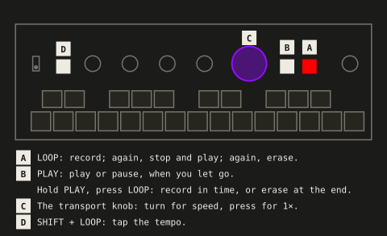

FRIZZ has one loop. It records the input before the effects, so you can play effects over it
without printing them into it. LOOP and PLAY run it:

| Looper | Key | Result |
|---|---|---|
| Empty | LOOP | Start recording |
| Recording | LOOP | Stop and play |
| Loop exists | PLAY | Play / pause, when you let go of PLAY (not if you pressed LOOP while holding it) |
| Loop exists | LOOP | Erase now, as LOOP goes down |

**More looper gestures:**

| Looper | Key | Result |
|---|---|---|
| Empty | hold PLAY, press LOOP | Start a **quantized** recording (needs MIDI clock from the [clock source](#clock-source), otherwise LOOP blinks red 3 times) |
| Recording quantized | LOOP | Stop at the end of the current bar, then play |
| Loop exists, playing | hold PLAY, press LOOP | Erase at the **end of the loop** (LOOP blinks red until then; paused, it erases now) |
| Erase waiting for the end | LOOP / PLAY | LOOP erases now; PLAY takes the erase back, the loop plays on |
| Any | SHIFT + LOOP | Tap tempo (see [Tap tempo](#tap-tempo)); never records, stops or erases |
| Loop exists | SHIFT + PLAY | As PLAY: play / pause |

- **Quantized:** recording starts on the press, which counts as bar 1 (4/4). Ending it records
  to the end of the bar in progress, so the loop is always a whole number of bars. It closes
  immediately if the clock stops.
- **Erasing** uses the gestures that record: LOOP at once, PLAY + LOOP quantized, here to
  the loop's own end, so it needs no clock. For half a second after LOOP stopped a recording,
  LOOP doesn't erase, so a double press can't lose the new loop.
- **Length:** up to 2:45. The loop lives in RAM and is gone at power-off. There's no overdub.
  The loop can also be one of your loops from the SD card, which then plays here as a recorded
  one does (see [Playing loops](#playing-loops)).
- **Level:** the loop never clips: a limiter holds what goes into it just under full scale
  (details in [Technical data](#audio)). If the meter on VOLUME's page 2 shows red on more
  than the loudest hits, turn the input gain down.

LEDs: LOOP is red while recording and blinks while a quantized recording finishes its bar or
an erase waits for the loop's end, at the slow blink everything waiting uses (a picked scene
slot, the CHOMPI key ready to confirm); a refusal is 3 quick blinks.
While a loop plays, PLAY and LOOP crossfade in white to show the position (dimmed when
paused).

PLAY also shows the beat the effects follow (see [Tempo and transport](#tempo-and-transport)), as the settings
page's lower G# does:

| Looper | PLAY |
|---|---|
| No loop | dim white for the first half of each beat |
| Recording | the same, a count while LOOP is red |
| Playing | the crossfade, with a short flash on each beat (whiter, or darker where PLAY is already bright), stronger on each bar's 1 |
| Paused | the dim position, the beat pulsing over it (the tempo runs on) |

LOOP's red blinks (a recording closing, an erase waiting, a refusal) show as above. The beat
dims with the [LED brightness](#led-brightness).

### Transport knob

The transport knob, the big purple one, sets the loop's speed: turn it for faster, slower or
backwards, press it for 1× forward again; paused, it scrubs. Its speed and scrub need a loop.
With a scene morph held (SHIFT + a scene key), it's the [crossfader](#crossfading-by-hand) and
the [drop](#dropping-to-a-scene) instead, with or without a loop.

| Control | Function |
|---|---|
| Turn while playing | Speed in semitones (2 detents per semitone), as TAPE's knob runs: from 2× down to 1/16×, then a **standstill** for about 4 detents (the tape glides to a stop, 0×), then reverse from −1/16× up to −2×; the same way back. Stops at 2× and −2× |
| SHIFT + turn while playing | Speed in 5ths and octaves (4 detents per step): from between two of them, to the next one in the turn's direction. Past 1/16× it flips into reverse at the same speed and climbs back up to −2×; from a standstill, 1/16× the way you turn |
| Turn while paused | Scrub |
| SHIFT + turn while paused | Nothing |
| SHIFT + turn, with a scene morph held | The [crossfader](#crossfading-by-hand), playing, paused or without a loop |
| Press | Back to 1× forward |
| SHIFT + press, with a scene morph held | A [drop](#dropping-to-a-scene), with or without a loop |
| SHIFT + press otherwise | Nothing (the [bug report](#bug-reports) is on the settings page) |

- **Standstill** (the transport knob between 1/16× and −1/16×): the tape glides to a stop
  and the loop fades out with it, a tape stop rather than a click, and stays silent while it
  stands. The effects' beat runs on by itself as while paused (see [Tempo and transport](#tempo-and-transport)), at the
  slowest speed's tempo, 50 BPM, so a scene morph still lands on its bar line. Turned on, the
  loop fades back in with the speed, and the beat snaps back onto it.

The transport LEDs show speed and direction while it plays (both red at a
standstill), the scrub speed in white while it's paused, and nothing without a loop.

## Tempo and transport

<!-- summary: One tempo for every effect: the loop's, a MIDI clock's or tapped. -->

Every effect that follows a tempo follows the same one: the loop's while there is one,
otherwise a MIDI clock's, otherwise the last tempo, tapped or left by a loop or a clock. The
effects that do are the delay, the filter LFO, the freezer, the slicer, the tape stop, the
phaser's rate in its synced half and the chaos key's grid; the [clock factor](#clock-factor)
can double or halve their tempo. In detail, the first that applies:

1. **The loop, while there is one**, with or without MIDI clock. Beat 1 is the loop's start,
   so the slicer chops on the loop's beat from the first pass and the delay's echoes land on
   it. The effects follow the transport knob: at half speed the tempo halves and in reverse
   the beats run backwards. Once a loop exists, MIDI clock no longer matters: a tempo change
   in your DAW moves neither the loop nor the effects.
2. **MIDI clock**, when there's no loop, from the input the [clock source](#clock-source)
   picks (none when it's internal). The effects get it in whole BPM, measured over the last
   few seconds, so it holds still however unsteady the clock: a clock that starts is taken
   once a few of its ticks are counted (within a quarter of a second, the beat from its first
   tick), a jump in tempo is followed at once, a change of a BPM or so within about 2 seconds.
3. **The last tempo**: tapped, from the last loop or from the clock. 120 BPM at power-on.

While the loop is paused, the beat runs on by itself at the loop's tempo, so the effects keep
working on the input; scrubbing doesn't move it. At a [standstill](#transport-knob) it does the
same, at the slowest speed's tempo (50 BPM). When the loop plays again, the beat snaps back
onto it at the next 1/48 of a bar: a filter LFO or slicer can jump there.

A loop gets a whole number of beats:
- **Quantized:** its bars from the clock it was recorded to, exactly.
- **Unquantized, after a tempo was set** (by a clock, taps or an earlier loop): the number
  of beats closest to that tempo. Record at the tempo you tapped and the loop takes it on.
- **Unquantized, with no tempo set:** a guess: 1, 2, 4, 8 … beats, whichever puts it
  between 80 and 160 BPM. It goes wrong on loops of 3 or 6 bars, or with a pickup, and may
  come out at half or double the tempo you had in mind. Tap to correct it.

With MIDI transport following on, a DAW's Start and Stop play and pause the loop too: see
[Start and Stop](#start-and-stop).

### Tap tempo

**SHIFT + LOOP:** tap at least 3 times, at the tempo you want; the last 5 taps (4 gaps) count,
and a pause of over 2 s starts over. LOOP flashes on each tap: white, or dark when it's
already lit nearly white.
- With a loop, the taps pick how many beats the loop holds; the loop's length then gives the
  exact tempo, so the effects' beats stay locked to it even if the taps were a little off,
  delay times and freezer lengths included. Tapping
  at double the loop's tempo, for example, doubles the effects' tempo.
- Without a loop, the taps set the tempo, and the last tap lands on a beat.
- Tap the tempo you hear: the [clock factor](#clock-factor) applies on top of it.
- Without a loop while MIDI clock runs, the clock is the tempo: LOOP blinks red 3 times.
  With the [clock source](#clock-source) on internal, no clock counts, and the taps set the
  tempo.

The tempo is limited to 50-300 BPM, after the clock factor: at very slow loop speeds the
effects stop slowing down at 50 BPM.

### Clock factor

The lower G# on the [settings page](#settings-page) sets it, each press the next:
**as sent** (yellow, the default), **double** (red), **half** (light blue). It multiplies the
effects' tempo, whichever of the 3 above it comes from: tap the tempo of a song on AUX
(SHIFT + LOOP), then put the delay, the slicer and the rest at double or half of it; or
record a loop and let the effects run at half its tempo. The loop itself stays as it is: its
length, its beats, and the bars a quantized recording ends on. With MIDI clock, FRIZZ
follows the clock at the factor (see [MIDI clock](#midi-clock)), so a loop recorded to a
120 BPM clock at double has the effects at 240.

- Changed while a loop plays, the effects' beat stays on the loop: beat 1 on its start.
  Without a loop, a tapped beat stays on the beats you tapped: at double with one more
  halfway, at half on every other one.
- At half, a loop of an odd number of beats (3, say) holds a beat and a half per pass.
  The effects' beats run on evenly across its start, so beat 1 lands on the loop's start
  every other pass, and halfway through a beat on the others. A quantized loop always holds
  whole bars, so it's never one of them.
- The 50-300 BPM limit applies after the factor: 200 tapped at double is 300, at half 100.
- The beat on the lower G# and PLAY and the clock [MIDI out](#midi-out) sends show the tempo
  with the factor.

It's kept as `clock_factor` in `FRIZZ/frizz_master.txt` (50, 100 or 200).

## Loop loader

<!-- summary: Your own loops and TAPE's recordings from the SD card. -->

FRIZZ plays loops from the SD card: your own, 8 banks of 15, one on each white key of the
**Loops page** (SHIFT + the lower C#), and the recordings you made with TAPE (its cubbis) on the
**Cubbi page** (SHIFT + the lower D#). A loop
from the card is the loop, as if you had recorded it: LOOP, PLAY, the transport knob and the
input/loop mix act on it the same way. This chapter is about getting loops onto the card;
[Playing loops](#playing-loops) is about the two pages and switching, at once or at the end of
the loop playing, and [Loops and scenes](#loops-and-scenes) about switching together with a
[scene change in time](#scene-changes-in-time).

**A loop you recorded is gone once you switch to a loaded one.** FRIZZ doesn't save your
recordings to the card, and there's no way back to the recording.

### Loops on the card

Put your loops in the folder `FRIZZ` on the card, beside the scenes and settings, named for
their bank and key: `a1.wav` to `a15.wav` for bank a, `b1.wav` to `b15.wav` for bank b, and so
on to `h15.wav`. The letter is the bank, the number the white key from the left (`a1.wav`, not
`a01.wav`); upper or lower case doesn't matter. A missing name is an empty key. To get them
onto the card, use the [Companion](#the-companion) over the USB cable, lend the card to the
computer [as a USB drive](#the-card-as-a-usb-drive), or use the launcher's [USB storage
mode](INSTALL.md#usb-storage-mode); FRIZZ reads the card when it starts, and again when it
comes back from the computer.

- **WAV, 16-bit, 48 kHz**, stereo or mono (a mono loop plays on both sides).
- **At most about 77 s**: 16 bars at 50 BPM.
- Anything else (44.1 kHz, 24-bit, compressed, longer) is refused: its key shows dim red.
- A WAV with an `acid` chunk (many sample packs and DAWs write one) says how many beats it
  holds, and FRIZZ takes its tempo from that, if the chunk comes before the audio data in the
  file (the Companion writes it there). Otherwise FRIZZ guesses the beats (see
  [A loaded loop is the loop](#a-loaded-loop-is-the-loop)).

### The Companion

The **FRIZZ Companion**, [frizz.friedrichwagner.eu/companion](https://frizz.friedrichwagner.eu/companion/),
is a web page that manages your loop banks over the USB cable while FRIZZ plays. Plug the
CHOMPI into the computer, open the page and let it use MIDI: it shows what's on the card,
FRIZZ's 8 banks of 15 with each loop's name, and TAPE's cubbis. Then:

- **Upload:** drop audio files (WAV, AIFF, MP3 …) on the slots. The page turns each into what
  FRIZZ plays (16-bit, 48 kHz, at most about 77 s, a mono file stays mono) and writes its name
  and, where it knows them, its beats into the file.
- **Arrange:** move, swap and delete loops between FRIZZ's slots, or copy a cubbi of TAPE's into
  one (TAPE's own file stays as it is).
- **Confirm,** and the page carries the whole batch out with a progress bar. A loop that plays
  plays on; its key plays the new file the next time you pick it. The bright key is the slot
  that holds the loop playing: moved or swapped, the light goes with it; replaced or deleted,
  no key is bright for it.

- **Browsers:** Chrome, Edge and the other Chromium-based ones, and Firefox, which asks you once
  to allow a small add-on for the site. Safari has no MIDI for web pages.
- **On Linux, Chrome and Edge find no FRIZZ** while some audio interfaces are plugged in
  (Focusrite Scarlett, Clarett and Vocaster, RME HDSP): a fault in them hides every MIDI device
  then. Use Firefox, or unplug the interface while you use the page.
- **Speed:** uploads go over MIDI, about two minutes for the longest loop (16 bars at 50 BPM,
  stereo) and more on a slower computer; a mono loop takes half. For many loops at once,
  lending the card [as a USB drive](#the-card-as-a-usb-drive) is several times faster (a card
  reader too).
- **While FRIZZ records a loop, loads one or saves to the card,** an upload waits and goes on
  by itself. Lending the card to the computer stops an upload: the page waits, and once the
  card is back it sends that loop again from its start (the slot keeps its old loop until
  then). Switching [USB audio](#usb-audio) on or off ends an upload. A card too full for a loop
  refuses it.
- **Nothing half is left:** an upload cut short (the tab closed, the cable pulled, the power
  off) leaves the slot as it was. If the CHOMPI doesn't answer (another firmware, or an
  older FRIZZ), the page says so.
- **The loops' names** are written into their files, and FRIZZ reads them, but only the
  Companion shows them: the panel has no place for a name.

## Playing loops

<!-- summary: The Loops and Cubbi pages, and switching between loops. -->

Loops from the card play from two pages of their own, the **Loops page** for yours and the
**Cubbi page** for TAPE's, where the white keys are the loops. To get loops onto the card, see
[Loop loader](#loop-loader).

On the play page the two keys that open them show what the card holds: the lower C# glows
dimly in the colour of the first bank with a loop of yours, the lower D# in that of the first
bank with a cubbi, and each stays dark when the card has none. They show what's on the card,
not what's playing, and follow the card when loops come or go. While a loop waits to switch
(see [Switching loops](#switching-loops)), its page's key blinks in its bank's colour instead,
on the beat.

### The Loops page

**SHIFT + the lower C#** opens the Loops page. **SHIFT + the lower C#** again, or **two quick
taps of SHIFT** (each a short tap with nothing else in between), takes you back to the play
page. On the play page a double tap does nothing, so it's a safe way home wherever you are,
unless CHOMPI blinks to confirm a save, copy or delete: there its first tap confirms it.
**SHIFT + the lower D#** takes you to the [Cubbi page](#the-cubbi-page). Opening the Loops page
ends a [save, copy or delete](#save-copy-and-delete) you had started. Flipping the mode switch
up and down again brings you back to the page you were on. With no loop file on the card, the
page opens with its white keys dark, and the lower C# and D# blink red 3 times.

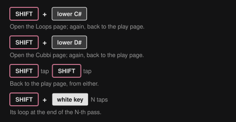

While you're on the Loops page, the CHOMPI key glows dimly in the bank's colour (white while
you hold it as SHIFT). The CHOMPI key's LED only ever shows SHIFT held, the page you're on,
a scene save, copy or delete waiting for its confirm, the start-up ripple and the low-battery
warning.

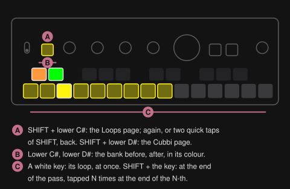

| Control | Function | LED |
|---|---|---|
| Lower C#, lower D# | The bank before, the bank after; banks without a file are skipped | each in the colour of the bank it leads to; dark at the first or last bank, where a press blinks red 3 times |
| A white key | Switch to its loop at once | see below |
| SHIFT + a white key, tapped N times | Switch at the end of the N-th pass | blinks on the beat while it waits |
| SHIFT + a scene key, the transport turned, a white key | Both loops on the crossfader | see [Two loops on the crossfader](#two-loops-on-the-crossfader) |
| Scene keys, the transport knob, PLAY, LOOP, SHIFT + LOOP, VOLUME | As on the play page | as on the play page |
| Knobs 1-4, upper F#, G#, A# | Nothing | dark |

The banks' colours: A orange, B yellow, C green, D teal, E light blue, F blue, G purple,
H pink. The bank you're on shows on the CHOMPI key and the white keys; the lower C# and D#
show where they lead. A white key shows its loop:

| LED | Means |
|---|---|
| Dark | No loop on that key; pressing it blinks red 3 times |
| Dim, the bank's colour | A loop |
| Dim red | A file FRIZZ refuses; pressing it blinks red 3 times |
| Bright | The loop playing |
| Blinking on the beat | Planned: it takes over when its time comes |
| Blinking fast | Planned, still loading from the card |

The effects can't be punched in by hand there, since the white keys are the loops, but the
latched ones and the [chaos key](#chaos-key) play on, and MIDI notes still play the effects.
Notes 66, 68 and 70 do nothing there, as the upper F#, G# and A# don't, nor do notes 36-39, as
the knobs' presses don't.

### The Cubbi page

The Cubbi page plays what you recorded with TAPE, the CHOMPI's sampler firmware: its
**cubbis**, the recordings TAPE keeps one on each white key, in 5 banks, a to e. You don't copy
anything: FRIZZ reads them where TAPE keeps them, and never changes them.

- **Where:** in the folder `TAPE` on the card if there is one (the multi-firmware launcher's
  TAPE keeps its files there), otherwise in the card's root (TAPE on its own). If there's a
  `TAPE` folder, FRIZZ looks only there, as the launcher's TAPE does.
- **Which:** the files `cubbi_a1.wav` to `cubbi_e15.wav`, the bank's letter and the white key
  from the left, as TAPE names them. TAPE's other files (its chromatic samples, `jammi_…`, and
  the `…_double.wav` copies it keeps for fast playback) aren't loops, and FRIZZ leaves them out.
  TAPE's own 15th key plays its recording buffer rather than a file, so the 15th key here is
  usually dark.
- **What it takes:** what TAPE records, 16-bit 48 kHz stereo, up to about 77 s, as on the
  [Loops page](#loops-on-the-card). TAPE can record up to about 165 s: a longer cubbi shows dim
  red, and pressing it blinks red 3 times.

**SHIFT + the lower D#** opens the Cubbi page, from the play page or the Loops page. **SHIFT +
the lower D#** again, or **two quick taps of SHIFT**, takes you back to the play page, and
**SHIFT + the lower C#** to the Loops page. Everything else works as on the
[Loops page](#the-loops-page): the lower C# and D# step the banks, a white key switches at
once, SHIFT + a white key at the end of a pass or with a scene change, the same LEDs. Each
page remembers its bank (or opens on the first bank with a file, if that one has none), and
there's one plan for both: a loop planned on one page is replaced
by a key on the other. With no cubbi file on the card, the page opens with its white keys dark,
and the lower C# and D# blink red 3 times.

The banks show in TAPE's own colours, so you recognise them: a purple, b orange, c teal,
d dark orange, e yellow-green. While you're on the page, the CHOMPI key glows dimly in the
bank's colour, and the lower C# and D# in the colours of the banks they lead to.

### Switching loops

- **A white key** switches to its loop at once, with a short crossfade (10 ms). It keeps time: the
  new loop starts as far into its pass as the loop playing is into its own, counted round
  the new loop's length. So two loops at the same tempo stay on the beat, whatever their
  lengths and whatever tempo FRIZZ guesses for them. With no loop playing it starts from the
  top and the input/loop mix goes to the loop, as after a recording; paused, it waits at its
  start for PLAY. The key of the loop playing starts it again from the top.
- **SHIFT + a white key** switches at the end of the loop playing, without a gap, the new
  loop from its start. Tap the white key more times for more passes: twice is the end of the
  next pass, and so on, up to 8. The passes count from when you let go of SHIFT. With no loop
  playing, or paused, it switches at once.
- **The last white key counts:** another white key replaces what you planned.
- **Loading** takes under a second for the longest loops. A loop not loaded by its time
  switches at the end of the first pass after it is.
- **To cancel**, hold SHIFT again (in a new hold: in the one that planned it, a tap adds a
  pass) and tap the blinking key: nothing switches, and a scene change running stops where it
  is.
- A white key while LOOP records blinks red 3 times.

### A loaded loop is the loop

- **LOOP** erases it, as it erases a recording (and a switch waiting with it); then LOOP
  records a new one. **PLAY** pauses and plays it; the **transport knob** changes its speed,
  scrubs it while paused.
- **The tape runs on across loops.** Every switch keeps the transport's speed and direction:
  at once, planned, with a scene and on the crossfader. A loop you switch to at double speed
  plays at double speed; in reverse it starts from its end, in reverse; at a standstill it
  stands too. Only erasing (LOOP) puts the tape back to 1× forward, so a new recording, or a
  loop loaded after an erase, starts at 1×; pressing the transport knob is 1× forward, as
  always.
- **Its tempo:** a loop's tempo is its own times the speed, and the effects' tempo follows it
  from the switch. FRIZZ takes its beats from its [`acid` chunk](#loops-on-the-card); without
  one it guesses them from its length: the power of two beats (1, 2, 4, 8 …) that puts it
  closest to the tempo of the loop playing (at 1×), or to the last tempo, between 50 and 300
  BPM; at power-on, with no tempo set yet, the one that puts it between 80 and 160 BPM, as for
  a recording. If that lands at half or double the tempo, or the loop holds 3 or 6 bars,
  [tap the tempo](#tap-tempo) (SHIFT + LOOP) and the beats fit again.

### Loops over MIDI

A DAW or a controller picks loops with a bank select and a program change, on FRIZZ's global
channel, from any page: CC 0 = 1-8 for FRIZZ's banks a-h, 9-13 for the cubbis' a-e, then
program change 0-14 for the white key. CC 54 says when it switches (at once, at the end of a
pass, or with a scene change), and CC 81 cancels. With [MIDI feedback](#midi-feedback) on, a
switch you make by hand goes out the same way, so a DAW can record it. The details:
[Program changes](#program-changes).

## Loops and scenes

<!-- summary: Loops switched with a scene change, or crossfaded by hand. -->

A loop switch can go with a [scene change in time](#scene-changes-in-time), in the same SHIFT
hold on the Loops or Cubbi page: the loop lands with the morph or the drop, or the scene with
the loop at the end of its pass. On the [crossfader](#crossfading-by-hand), the two loops mix
as the two scenes do.

### A loop with a scene change

A loop can join a [scene change in time](#scene-changes-in-time) in the same SHIFT hold. As
everywhere in a SHIFT hold, **the first key decides**: a scene key first counts bars, a white
key first counts passes of the loop playing. Then let go of SHIFT.

**A scene key first: bars.** Tap the scene key once per bar, as for any scene change, then
optionally the transport (a drop) or a second scene key (a build-up), and a white key. The
white key only says which loop: tapping it again counts nothing, and another white key
replaces it.

- **With a morph**, the loop switches where the morph arrives.
- **With a drop or a build-up**, it switches with the drop, on its bar line.
- That can be in the middle of the loop's pass: it switches there with the short crossfade,
  the new loop from its start.

**A white key first: passes.** Tap the white key once per pass of the loop playing (another
white key replaces it), then a scene key. Everything lands together at the end of the N-th
pass, without a gap:

- **The scene key alone:** the scene morphs over those passes and arrives exactly at the end.
- **A second scene key:** a build-up to the first over the passes, the second dropping at the
  end.
- **The transport pressed:** the scene drops at the end.

Here the scene key's taps count nothing: the first scene key is the one you go to, a
different one the drop of a build-up. Turning the transport makes it the
[crossfader with both loops](#two-loops-on-the-crossfader), and the passes no longer count;
without a scene key in the hold, SHIFT + the transport turns the speed as always, and the
switch stays planned.

For both:

- If the loop isn't loaded by its time, the scene lands anyway and the loop follows at the
  next bar line (or pass end) once it is. If the loop is erased while a scene waits for the
  pass end, the scene lands on the next bar line.
- **SHIFT + any blinking key** (the scene's or the loop's) cancels all of it: the scene stops
  where it is and the loop doesn't switch. A scene recalled meanwhile, or the change stopped
  any other way, takes its loop with it.

A planned switch carries on if you leave the Loops page. On the play page the lower C# (the
lower D# for a cubbi) then blinks in the loop's bank colour, as its key on the Loops page does,
until it switches, and glows again after.

### Two loops on the crossfader

Hold SHIFT, tap a scene key and turn the transport knob: that's the
[crossfader](#crossfading-by-hand). Tap a white key in the same hold, before or after you turn,
and the crossfader mixes the two loops as it mixes the two scenes: on the left the loop
playing and its scene, on the right the new loop and the new scene, and both loops in between.

- **The new loop joins in time**, as a white key at once does: as far into its pass as the
  loop playing is into its own, at the tape's speed.
- **Let go of SHIFT:** the scene stays where the fader is, as always. The loop goes to the
  nearer side: from the middle on, the new loop takes over where it is and sets the tempo;
  below the middle, the loop playing stays and the new one is gone. Fully right is the new
  loop and the new scene, fully left the old ones.
- **Until you let go**, the effects' tempo, the beat and MIDI out follow the loop playing.
- **Another white key** in the hold replaces the new loop, with a quick fade; the same key
  again, or the key of the loop playing, does nothing. A scene recalled meanwhile (or a
  program change, or CC 81) drops the new loop.
- **It's only clean with two loops at the same tempo**, or with pads and textures without
  drums in the same key. FRIZZ mixes the two loops, it doesn't match their tempos: two loops
  at different tempos drift apart under the fader.

<!-- part: Effects -->

## Sound architecture
<!-- summary: From the input through the looper and the effects to the outputs. -->

How the sound goes through FRIZZ, from the input to the outputs.

### Signal flow


The input is AUX, the built-in microphone while no cable is in AUX, or a computer on USB (see
[Input: AUX, the mic or USB](#input-aux-the-mic-or-usb)). It goes to the looper and, through the
input/loop mix (SHIFT + VOLUME), to the effects on the white keys, then to the
finalizer, VOLUME and a fixed safety limiter on every output. The looper records the input
before the effects, so an effect is never printed into a loop; a loop
[from the card](#loop-loader) plays from the looper as a recording does. The settings page can
send the input past the effects and the finalizer instead; it joins again before VOLUME.

The master out always carries the whole signal; the headphones carry the same, or the input
alone (see [VOLUME knob](#volume-knob)). Over USB, the computer gets the master before VOLUME
(see [USB audio](#usb-audio)).

### Effect chain


The white keys run in signal order, left to right:

```
freezer -> shifter -> folder -> crusher -> filter -> flanger -> phaser -> slicer -> wow & flutter
           |<------------------- resonator loop -------------------->|
  -> tape stop -> delay -> reverb
```

The white keys are of these kinds:

- **Inserts**, white keys 1-7 and 9-11 (the freezer to the phaser, then the slicer, wow &
  flutter and the tape stop): replace the signal while on and stop the moment they're off.
  The tape stop spins back up first.
- **The resonator**, white key 8: a comb feedback loop. While on, it taps the signal after
  the phaser and feeds it back in after the freezer, so it rings through the shifter, folder,
  crusher, filter, flanger and phaser whenever they're on.
- **Sends**, white keys 12 and 13 (the delay and reverb): the key opens the effect's input,
  and its output is added to the signal, so tails ring out after the key is released.
- **White key 14**, the [chaos key](#chaos-key), makes no sound of its own but plays with the
  others. White key 15 is the [finalizer](#finalizer)'s, after the chain.

What the order does:

- The freezer comes first, so it captures the clean sound and everything after it works on
  the repeats. The folder folds the clean signal and the crusher grinds the folds; the filter
  sweeps both, and the flanger and the phaser sweep what they made. The slicer chops
  everything, the resonator's ringing too.
- Wow & flutter and the tape stop are the last inserts, so they bend everything before them.
  They come before the sends: a tape stop slows the music to a halt while the echoes and the
  reverb ring on.
- The delay gets the inserts' output; the reverb gets that plus the delay's echoes, so the
  echoes are reverberated while both are on. The delay's tail rings out as plain echoes: its
  random events only start while its key is on.

### Tempo and MIDI


The effects that follow a tempo share it with a quantized recording and MIDI out: see [Tempo
and transport](#tempo-and-transport). MIDI comes in over TRS and USB alike, and MIDI out sends
FRIZZ's clock and the loop's transport: see [Appendix: MIDI](#appendix-midi).

## Punch-in FX
<!-- summary: Playing the effects on the white keys: hold, latch, knobs. -->

Effects sit on the white keys and act on the whole input/loop mix, before the
finalizer and VOLUME. The looper records the input before the effects, so an effect is never
printed into a loop. Inserts stop the moment they're off, the delay and reverb ring out (see
[Effect chain](#effect-chain)). Some heavy combinations of effects can need more processing
time than there is, heard as crackles (see [Processing load](#processing-load)).

### Playing an effect

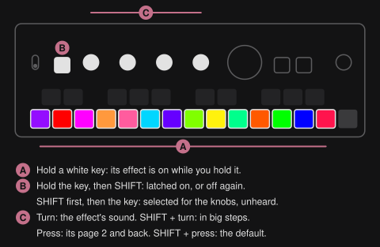

| Control | Function |
|---|---|
| Hold an FX key | Effect on while held; the knobs edit it |
| Hold an FX key, then SHIFT | **Latch** on / off: the effect stays on after release. Hold several FX keys, then SHIFT, to latch them all |
| SHIFT, then an FX key | **Latch** on / off as well: the order doesn't matter. Keep SHIFT held and tap more FX keys to latch (or unlatch) each |
| FX key on a latched effect | Stays latched: the knobs edit it. To unlatch it, SHIFT and the key |
| Knobs 1-4 | The parameters of the most recently pressed FX key, 1% per detent, faster when turned fast |
| SHIFT + knobs 1-4 | Coarse: the next point of the parameter's grid per detent (see [Coarse steps](#coarse-steps)) |
| SHIFT + press knobs 1-4 | Resets that parameter to its default, on the page shown |
| Press knobs 1-4 | The effect's page 2, and back (see [Page 2](#page-2)) |

The details of the timing:

- **Latch: SHIFT and the key, in either order.** SHIFT held when the key goes down, or
  pressed while you hold the key, latches it, or unlatches a latched one. SHIFT let go just
  before the key goes all the way down (up to about 15 ms) still counts as held.
- **The latch is settled when you let go of the key:** you hear the effect while you hold
  the key, whichever came first, and it stays on (or goes off) when you let go, also after
  letting go of SHIFT first. Holding an FX key and using SHIFT for something else (a coarse
  turn, tap tempo, the input/loop mix, selecting the finalizer) doesn't latch it. Another FX
  key in the same SHIFT hold isn't something else: hold the filter, press SHIFT, tap the
  shifter, and both latch.
- **A plain press never changes a latch:** it plays the effect while held and puts it on the
  knobs, so you can edit a latched effect with a tap of its key. There's no way to put an
  effect on the knobs without hearing it by hand: MIDI's focus does that (CC 23, see
  [Controllers](#controllers)).
- **Stepped parameters** move one step per 3 detents: the shifter's shift, the filter's LFO
  and the delay's divisions, the freezer's length and roll, the slicer's pattern and stereo,
  the tape stop's stop and spin-up times, the flanger's polarity, the chaos key's grid, the
  phaser's rate right of its centre (and the frequency shifter's shift there).
- **Turning speed:** a knob turned slowly moves 1% a detent, for a precise setting. Turned
  faster than about 8 detents a second, its step grows smoothly, up to 5% a detent from about
  40 a second, so a quick sweep across the whole range takes about one turn. Turned slowly
  again, it's back to 1% from the next detent, and a value still stops exactly at 0% and 100%.
  The finalizer's knobs speed up the same way; SHIFT + turn and the stepped parameters keep
  their steps however fast you turn.

### Keys and knobs

The FX keys are coloured by their place in the signal chain: the keys of a stage share a
colour, the two of a pair in neighbouring shades (the freezer purple and the shifter indigo,
the folder scarlet and the crusher orange, the flanger light blue and the phaser blue, wow &
flutter red and the tape stop rose, the delay green and the reverb teal), and the next stage
in a colour well apart. The phaser's second mode, the frequency shifter, turns its key ice
blue. The chaos key, which has no place in the chain, is magenta.

The FX keys are dimly lit in their effect's colour while off and at full brightness while
on, where the audio coming out of the effect pushes the colour towards white, from -30 dBFS
up, the peaks most. The delay and reverb keys follow their returns, so after release they
glow with the tail, fading from full back to dim. The knob LEDs show the parameter values in
the effect's colours; a knob the effect doesn't use is dark and does nothing. Values reset at
power-off unless they're saved in a [scene](#fx-scenes).

The knob LEDs use white for one thing only, a neutral point. A knob with a centre (the
shifter's shift and grain, the filter's cutoff, the delay's random and damping, every Band,
the frequency shifter's direction, the finalizer's Input and its EQ and Width bands)
is white there, blue below and orange above, the same on every effect, so you can see at a
glance which way a knob is off. Every other knob starts in its key's colour and goes to a
second one, well apart from it. The phaser's rate shows which half it's in: its own colours while it runs free,
green to yellow once it follows the tempo. Page 2's knob 4 shows what the effect puts out
instead of its value (see [Page 2](#page-2)).

The knobs do the same kind of job on every effect, so you can find a setting without
looking it up:

| Knob | Role | Where an effect has none |
|---|---|---|
| 1 | The main control: length, pitch, drive, rate, cutoff, pattern, wow, stop time, division, decay | — |
| 2 | Feedback (the filter's resonance) | its second main control: shape, bits, decay, flutter, spin-up time, diffusion |
| 3 | Tone or colour: tone, roll, swoop, amount, LFO depth, chance, curve, random | — |
| 4 | A setting of the effect's own, the one you play: gate, grain, symmetry, XOR, LFO division, polarity, centre, env mod, shuffle, age; ducking on the delay and reverb | the tape stop's depth |

The chaos key makes no sound, so its knobs are its own: 1 the FX chance, 2 the scramble
chance, 3 the grid, 4 random to pattern.

Every insert starts silent or nearly so: the knob that brings it in (shifter shift, folder
drive, crusher rate and bits, filter cutoff, flanger amount, resonator feedback, wow and
flutter, phaser depth) starts at off, the others at a setting that sounds good, so one turn
brings the effect in. Three can't be silent: the freezer starts at 1 bar, so a shorter press
only hears the incoming signal; the slicer at every step on with the longest decay, a slight
pump; and the tape stop stops on every press, over 1/2 bar. The delay and reverb are heard
from the first press: their key is what sends sound into them, and their level (page 2's
knob 4) starts at 0 dB, as every effect's. SHIFT + press on a knob takes it back there.

Each effect has its own chapter after this one, with its knobs on both pages and its details:
[Freezer](#freezer), [Shifter](#shifter), [Folder](#folder), [Crusher](#crusher),
[Filter](#filter), [Flanger](#flanger), [Phaser](#phaser), [Resonator](#resonator),
[Slicer](#slicer), [Wow & flutter](#wow--flutter), [Tape stop](#tape-stop),
[Delay](#delay), [Reverb](#reverb) and the [Chaos key](#chaos-key).

### Page 2

A press on any of knobs 1-4 turns all four over to the selected effect's page 2: the parameters you set and leave rather than play. Another press turns them
back. Turning the page blinks its number on the four knob LEDs in white, as VOLUME's pages
do: twice for page 2, once for page 1 (a turn cuts it short). A knob the effect has nothing on
is dark and does nothing. Every effect but the chaos key has a page 2; the finalizer has none.

Pressing or selecting another effect, or the finalizer's key, always brings back page 1, so
the main controls are under your fingers whenever you pick an effect; pressing the key of the
one already selected keeps its page. SHIFT + turn and SHIFT + press work on page 2 as on
page 1. Turning the page doesn't edit the scene, and scenes, recalls and morphs carry page
2's values along with page 1's.

Page 2 is laid out the same on every effect that has one, so your hand learns it once:

| Knob | Page 2 | Default |
|---|---|---|
| 1 | **Mix:** the dry sound against the effect's, for parallel distortion, a harmony under the shifter, a half-frozen loop. On the delay and reverb: **Freeze** | fully the effect; freeze off |
| 2 | **Stereo:** how far the right channel parts from the left, each effect its own way (in its chapter). The tape stop, delay and reverb, which have no stereo knob, have a setting of their own there: darken, damping, pre-delay | off |
| 3 | **Band:** which part of the sound the effect works on. In the middle, all of it. Turned left, only the lows, below a split that falls from 20 kHz to 40 Hz; turned right, only the highs, above one that rises from 20 Hz to 8 kHz. The rest passes untouched, so a folder can grind the highs and leave the bass clean. On the delay and reverb it filters what goes in: right a low cut, left a high cut | the middle, all of it |
| 4 | **Level:** the effect's output, not the dry sound Mix blends in: off at the bottom, then -36 dB to +12 dB. Its LED is a meter of the effect's output (below). On the delay and reverb, the level of what comes back: the echoes, the room | 0 dB, at 3/4 |

**Knob 4's LED on page 2 is a VU meter** of what the effect puts out, in the colours of
VOLUME's meter: from dim through green and yellow to pink at full scale (-30 dBFS up), and as
bright as Level turns it, the way VOLUME's LED is as bright as VOLUME. So page 2 shows itself
whenever the effect sounds, and you see what Level does. It's measured after Level and Mix,
so at less than full Mix it shows some of the dry sound too. An effect that's off shows only
the dim floor. On the delay and reverb it shows their return (the echoes, the room, their
tails too, after the key is let go).

- **Nothing evens out levels by itself.** An effect that adds level, like the folder driven
  or the crusher's XOR on a quiet sound, comes out louder, and Level is how you set it.
  Level and Mix fade in and out with the key, as the effect does; with the key off, the
  sound passes untouched whatever page 2 says. The tape stop keeps them on while it spins up
  after you let go. The delay's and reverb's key fades what goes into them instead, and their
  Level stays, so their tails ring out at it.
- **At the defaults** an effect sounds exactly as without page 2.

### Coarse steps

SHIFT + turn moves one point of a fixed grid per detent, however fast you turn, always to the
next point in the direction you turn, so a value set finely snaps onto the grid with the first coarse move:

| Parameter | Coarse grid |
|---|---|
| Resonator pitch | The notes at A440 (110 Hz is A2), F#0 to A5 |
| Shifter shift | -12, -7, -5, 0, +5, +7, +12 semitones (octaves, fifths, fourths) |
| Shifter stereo | Quarter semitones |
| Mix and Band (page 2) | 10% |
| Level (page 2) | 6 dB steps, with 0 dB on one |
| Crusher rate | 48 kHz divided by 4, 8, 16, 32, 64: 12 kHz, 6 kHz, 3 kHz, 1.5 kHz, 750 Hz |
| Crusher bits | Whole bits |
| Folder drive | Doublings: 1×, 2×, 4×, 8×, 16×, 32× |
| Folder and crusher tone | Octaves down from open: 20 kHz, 10 kHz, 5 kHz … 312 Hz |
| Resonator tone | Octaves down from 15 kHz: 7.5 kHz, 3.75 kHz, 1.9 kHz |
| Wow & flutter tone | Octaves down from open, as the folder's and crusher's |
| Stepped parameters (freezer length and roll, filter LFO and delay divisions, slicer pattern and stereo, tape stop and spin-up times, flanger polarity, chaos grid) | One step per detent instead of per 3 |
| Phaser rate | Left of the centre the knob's 10% steps (0.02, 0.07, 0.4, 1 and 14 Hz), then each division, one per detent: from the free half up, the first stop is 1/16 on the centre; from the synced half down, past 1/16 onto the free half's 10%. The [frequency shifter](#frequency-shifter)'s shift on the same points |
| Phaser centre | Octaves: 100, 200, 400, 800 Hz … 6.4 kHz |
| Everything else, filter cutoff included | 10% steps |

## Freezer
<!-- summary: Grabs a slice of what's playing, from a whole bar down to a 16th, and repeats it while you hold the key. Turn up the roll for a beat repeat's build-up. -->

White key 1. Grabs a slice of what's playing, from a whole bar down to a 16th, and repeats it
while you hold the key. Turn up the roll for a beat repeat's build-up.

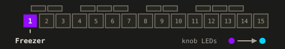

| Knob | Page 1 | Page 2 |
|---|---|---|
| 1 | Length: 1/16, 1/8T, 1/8, 1/4T, 1/4, 1/2T, 1/2, 1 bar (default 1 bar) | Mix |
| 2 | Feedback: the input overdubbed into the repeats (default 0, pure repeat) | Stereo: the left loop up to 45 ms longer (default off) |
| 3 | Roll: the length divided, off, 1/2, 1/4, 1/8, 1/16, no shorter than 1/64 bar; one step per 3 detents (default off) | Band |
| 4 | Gate: how much of each repeat you hear, all of it down to its first eighth, a stutter (default all) | Level |

- **Capture:** pressing the key waits for the next 16th, then records. The first pass is the
  incoming signal, so there's no gap; after one length it repeats. Releasing the key goes back
  to the incoming signal. Pressed again before the repeats have faded, they play on until the
  next 16th starts the new capture.
- **Length** follows the [tempo](#tempo-and-transport). The freezer keeps recording past the
  length (up to 5 s), so the length can be turned up while repeating; turned past what's
  recorded, it plays on through the recording until the length is reached.
- **Feedback:** at 0 the loop repeats unchanged. Turning up mixes the input into it (up to
  30% at 75%, 80% at the top, where the loop also fades by 10% per pass).
- **Roll:** a beat repeat's build-up, played by hand. Each step right halves the repeat: 1/2,
  1/4, 1/8 and 1/16 of the length knob 1 sets, never shorter than 1/64 bar (a triplet's stops
  a halving before). A step takes at the start of the next repeat, so the repeats stay on the
  grid, and each repeats the start of the capture, following on from the last repeat through
  the seam crossfade. Turned back to off, the next repeat is the whole length again, in one
  move. Where the knob is is the roll: nothing counts along behind it, and a capture with the
  roll still on 1/4 repeats a quarter of the length from the start. Set the length to 1/4,
  press the key, then turn the roll right a step at a time (1/8, 1/16, 1/32, 1/64) as the
  build-up; let go of the key, or turn the roll back to off.
- **Gate** silences the rest of each repeat, faded in and out over 2 ms: turned up, the
  repeats turn into a stutter.
- The seam where a repeat starts again has a 5 ms crossfade (shorter on repeats under 20 ms).
- LEDs: the key is purple; the knobs go purple to light blue.

## Shifter
<!-- summary: Shifts the pitch in semitones, with big steps at fourths, fifths and octaves. Feedback shifts again on every pass. -->

White key 2. Shifts the pitch in semitones, with big steps at fourths, fifths and octaves.
Feedback shifts again on every pass.

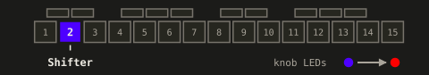

| Knob | Page 1 | Page 2 |
|---|---|---|
| 1 | Shift: -12 to +12 semitones, one step per 3 detents; centre off (default 0, off) | Mix: the dry sound under the shifted one, a harmony |
| 2 | Feedback: the shifted sound spirals (default off) | Stereo: the right channel up to a semitone higher; SHIFT + turn in quarter semitones (default off) |
| 3 | Swoop: on the key press, the shift pushes up to 2 octaves further and falls back over 1 s (default off) | Band |
| 4 | Grain: the window the shifter reads in, 10 ms (glitchy) through 30 ms (the centre, the default) to 50 ms (smooth) | Level |

- **Swoop:** each press pushes the pitch further in the direction of the shift, up to 2
  octaves, over 0.1 s, and lets it fall back over 1 s.
- **Feedback** sends the shifted output back in, so each pass shifts again: a fifth stacks
  into fifths.
- Two overlapping taps keep the pitch within about a cent of the interval, without wobble or
  buzz. The grain is how long each tap reads before it starts over.
- LEDs: the key is indigo; the shift and the grain go blue (down) through white (the centre) to
  orange (up), as every knob with a centre does, feedback and swoop indigo to red.

## Folder
<!-- summary: A wavefolder: past the fold point the signal mirrors back on itself, for bright, gritty overtones. -->

White key 3. A wavefolder: past the fold point the signal mirrors back on itself, for bright,
gritty overtones.

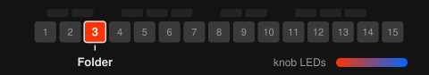

| Knob | Page 1 | Page 2 |
|---|---|---|
| 1 | Drive: 1× up to 32×, from barely folding to many folds (default 1×) | Mix |
| 2 | Shape: sine (smooth) to triangle (bright) (default sine) | Stereo: the right channel driven up to 2× harder (default off) |
| 3 | Tone, lowpass 200 Hz to open (default open) | Band |
| 4 | Symmetry: a bias for uneven folds and even harmonics (default off) | Level |

- **The fold:** past the fold point the signal is mirrored back, again and again as the
  drive rises, each fold adding harmonics. Drive is the folding: on loud material the folds
  start low on the knob, on quiet material higher up.
- **Level:** at 1× a quiet sound comes out at its own level, the bass too. Driven, a folder's output
  rises towards full scale whatever goes in, so the folder gets louder as you drive it, the
  more so on quiet material. Nothing evens that out by itself: page 2's Level and Mix are
  there for it.
- **Symmetry** shifts the fold by up to a quarter of its period: at the top, the sine fold
  becomes a cosine, all even harmonics, an octave-ish edge. The DC the bias adds is blocked.
- **Aliasing:** the sine fold stays clean; the triangle adds some grit on bright material
  high up the drive (the numbers are in [Audio](#audio)).
- In the resonator's loop, the folder folds the ringing on every trip.
- LEDs: the key is scarlet; the knobs go scarlet to azure.

## Crusher
<!-- summary: Fewer bits and a lower sample rate, down to 480 Hz, with a dive on every press. -->

White key 4. Fewer bits and a lower sample rate, down to 480 Hz, with a dive on every press.

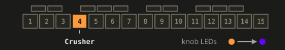

| Knob | Page 1 | Page 2 |
|---|---|---|
| 1 | Rate: 21.6 kHz down to 480 Hz, halving every 18% of the knob (default 21.6 kHz) | Mix |
| 2 | Bits: 16 down to 2 (default 16 bits) | Stereo: the right channel's rate up to an octave lower (default off) |
| 3 | Tone, lowpass 200 Hz to open (default open) | Band |
| 4 | XOR: flips bits of every sample for a digital buzz (default off) | Level |

- **Dive:** every press of the key drops the rate up to 10× over 0.1 s and lets it recover
  over 0.4 s.
- **XOR** flips fixed bits of each sample as 16-bit, a buzz that's loudest where the signal
  crosses zero. On its own XOR would turn silence into a constant offset, so what it adds is
  DC-blocked.
- **Level:** the XOR's flips and the coarsest bits are a fixed size whatever the signal's
  level, so on a quiet sound they come out louder than it (XOR at full on a sound 40 dB down:
  about 22 dB louder). Nothing turns that down by itself: page 2's Level and Mix are there
  for it.
- LEDs: the key is orange; the knobs go orange to violet.

## Filter
<!-- summary: A DJ filter, lowpass one way and highpass the other, with an LFO on the cutoff that follows the tempo. -->

White key 5. A DJ filter, lowpass one way and highpass the other, with an LFO on the cutoff
that follows the tempo: a state-variable filter, on the cutoff knob of WAVE's DJ filter.

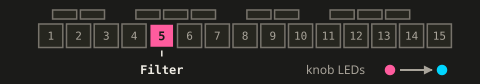

| Knob | Page 1 | Page 2 |
|---|---|---|
| 1 | Cutoff: lowpass left of centre, highpass right, flat at centre (default centre, flat) | Mix |
| 2 | Resonance (default 50%) | Stereo: the right channel's LFO up to half a cycle behind, so the sweep moves across (default off; only with the LFO) |
| 3 | LFO depth (default off) | Band |
| 4 | LFO division: 1/16, 1/8, 1/4, 1/2, 1 bar, 2 bars, 4 bars (default 1 bar) | Level |

- **LFO:** a triangle on the cutoff, synced to the [tempo](#tempo-and-transport). At full
  depth it sweeps half the cutoff knob either way, so from the centre it goes all the way
  from lowpass to highpass. It's at the centre of the cutoff on the beat and rises towards
  highpass first. Like the delay's events, the beat is counted from the loop's start, or
  without a loop from when the clock locked, not from the DAW's beat 1.
- **Slopes:** 12 dB per octave either way. The resonance goes from none to a peak of about
  20 dB at the cutoff; at the centre the filter is out of the sound, whatever the resonance.
- LEDs: the key is pink; the cutoff goes blue through white (flat) to orange, the other knobs
  pink to light blue.

## Flanger
<!-- summary: A swept short delay with feedback: the jet sweep, a chorus, or at the top a vibrato. -->

White key 6. A swept short delay with feedback: the jet sweep, a chorus, or at the top a
vibrato.

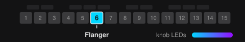

| Knob | Page 1 | Page 2 |
|---|---|---|
| 1 | Rate: 0.02 Hz to 50 Hz (default 0.55 Hz) | — (its Amount is its mix) |
| 2 | Feedback: up to 85% (default 42.5%, the knob at half) | Stereo: the right LFO runs free and detuned (default off) |
| 3 | Amount: sweep depth and how much you hear of it, together; the top is pure vibrato (default 0, off) | Band |
| 4 | Polarity: the feedback positive (metallic, the default) or negative (hollow), two steps | Level |

- **Amount:** one knob sets both the depth and how much of the swept sound you hear: around
  the middle it flanges and chorus-sweeps, at the top it's all delayed signal, a vibrato.
- **Pressing the key** restarts the sweep from the centre; pressed again right after you let
  go, while it still fades out, it goes on where it was.
- **Feedback** goes through the swept delay, a classic flanger's resonance.
- A ~12 ms delay, swept up to its full length either way by a triangle LFO.
- LEDs: the key is light blue; the knobs go light blue to purple.

## Phaser
<!-- summary: Sweeping notches with resonance, free-running or locked to the tempo. Hold SHIFT and tap key 7 twice for its other mode, a frequency shifter. -->

White key 7. Sweeping notches with resonance, free-running or locked to the tempo (after the
SP-404MK2's Phaser and the Elektron Tonverk's Phase 98). Its second mode is a
[frequency shifter](#frequency-shifter): SHIFT + key 7, then key 7 again.

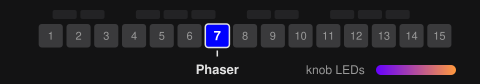

| Knob | Page 1 | Page 2 |
|---|---|---|
| 1 | Rate, in two halves: left of the centre free, 0.02 Hz to 50 Hz; from the centre right on the tempo, 1/16, 1/8, 1/4, 1/2, 1 bar, 2 bars, 4 bars (default 0.7 Hz, free) | Mix |
| 2 | Feedback: the resonance between the notches, up to 85% (default 34%, the knob at 40%) | Stereo: the right channel's sweep up to half a cycle behind (default off) |
| 3 | Depth: brings the notches in and widens the sweep, up to 2.5 octaves either way of the centre (default 0, off) | Band |
| 4 | Centre: the frequency the sweep moves around, 100 Hz to 6.4 kHz in octaves (default 800 Hz, in the middle) | Level |

- **Rate (knob 1), two halves on one knob.** Left of the centre it runs free, from 0.02 Hz
  (a sweep a minute) to 50 Hz (a buzz), on the flanger's curve. From the centre right it
  follows the [tempo](#tempo-and-transport), as the filter's LFO does: 1/16 on the centre,
  then 1/8, 1/4, 1/2, a bar, 2 bars and 4 bars at the top, a cycle each. So turning right goes
  faster in the free half, and from the centre on, slower again, through the divisions; the
  two halves meet where both are fast. The knob's LED shows the half: the phaser's colours
  (blue to orange) while free, green on 1/16 to yellow on 4 bars once synced.
  - Turning it by hand: 1% a detent in the free half (more turned fast, as every knob), a
    division per 3 detents in the synced half. Turning up out of the free half stops on 1/16
    first; turning down from 1/16 takes 3 detents back into the free half, just below the
    centre.
  - SHIFT + turn: 10% steps in the free half, a division a detent in the synced half,
    across the centre both ways.
  - Synced, the sweep is at the centre on the beat and rises first, like the filter's LFO,
    its beat counted from the loop's start (or from when the clock locked).
- **Feedback (knob 2)** sends the chain's output back into it: the notches sharpen and the
  peaks between them ring, up to 85%. The peaks get louder with it; it's turned down a
  little to make up.
- **Depth (knob 3)** brings the phaser in: at 0 the sound passes untouched, whatever the
  other knobs say. Over the first fifth of the knob the notches fade in, and from there on it
  only widens the sweep, up to 2.5 octaves either way of the centre at the top (from 800 Hz:
  140 Hz to 4.5 kHz). A morph fades the phaser in and out on it.
- **Centre (knob 4):** where the sweep is centred; SHIFT + turn moves it in octaves.
- **Stereo (page 2's knob 2):** the right channel's sweep lags the left's, up to half a
  cycle, so at the top one channel's notches go up while the other's come down.
- **In the resonator's loop:** with the resonator on, its ringing goes through the phaser on
  every trip, so the sweep moves through the resonances.
- **Level:** a phaser takes some of the sound into its notches, about 3 dB of a full mix,
  more with feedback up; page 2's Level is there for it.
- **How it works:** six allpass stages in a row on each channel, the sound added to them, and
  feedback from the end of the chain back into it. They cut three notches into the sound, the
  middle one on the sweep's frequency, one about two octaves below it and one about two above;
  a triangle LFO sweeps them up and down in octaves around the centre (knob 4).
- LEDs: the key is blue; the knobs go blue to orange, the rate's synced half green to
  yellow.

### Frequency shifter

The phaser's second mode moves every frequency in the sound up or down by the same number of
Hz. A pitch shifter keeps the harmonics in tune with each other; this doesn't, so they no
longer line up. A few Hz with feedback, and the direction (knob 4) turned to one side, make a
barber pole, a sweep that rises (or falls) and never ends; tens to hundreds of Hz make a sound
metallic and bell-like. After Mutable Instruments' Warps.

- **Switching:** hold SHIFT and press key 7 twice: the frequency shifter, the key ice blue.
  SHIFT + key 7 twice switches the mode and leaves the latch as it was: a latched phaser goes
  on as the frequency shifter (with a short gap between the two presses), an unlatched one
  stays off. The first press latches (or unlatches) as ever, the second puts that back and
  switches. Every further press in the same hold switches back and forth, however long you
  wait between them. The first press can also be key 7 held, then SHIFT. Letting go of SHIFT,
  or pressing any other key, starts over: the next SHIFT + key 7 latches or unlatches. To
  latch it and switch, hold SHIFT and press key 7 twice, then once more in a new SHIFT hold.
  The key lights up fully for a moment on each switch. It doesn't work on the Loops and Cubbi
  pages, where the white keys are loops.
- **Playing it:** key 7 plays the effect in the mode it's in, held or latched as ever. The
  knobs stay where they are when you switch, and are read the other way:

| Knob | Page 1 | Page 2 |
|---|---|---|
| 1 | Shift, in two halves: left of the centre free, 0.1 Hz to 1 kHz; from the centre right a cycle per tempo division, 1/16 to 4 bars (default 10 Hz, free) | Mix |
| 2 | Feedback: the shifted sound shifted again, up to 90% (default 36%, the knob at 40%) | Stereo: the right channel turned the other way (default off) |
| 3 | Depth: brings the shifted sound in, all of it at the top (default 0, off) | Band |
| 4 | Direction: down at the left, both ways in the middle, up at the right (default both) | Level |

- **Shift (knob 1):** its free half is a curve, a tenfold every eighth of the knob: 0.1 Hz at
  the left, 10 Hz halfway to the centre, 1 kHz just below it. From the centre right, the shift
  follows the [tempo](#tempo-and-transport), a full cycle per division of the phaser's rate
  (1/16 on the centre to 4 bars at the top: at 120 BPM, 8 Hz down to 0.125 Hz), so the barber
  pole turns in time; with the loop in reverse, it turns the other way. Turning it works as
  the phaser's rate does; SHIFT + turn steps the free half through 0.1, 0.63, 4, 25 and
  158 Hz, then a division a detent.
- **Feedback (knob 2)** sends the shifted sound back in, so it's shifted again on every trip,
  through a lowpass and a soft limit: with a few Hz of shift and the direction to one side,
  the barber pole; with the direction in the middle, both ways at once, it rings instead. The
  repeats add up, so the level is turned down a little as it rises.
- **Depth (knob 3)** brings the shifted sound in: at 0 the sound passes untouched, at the top
  you hear only the shifted sound. In between, the two together beat against each other. A
  morph fades the frequency shifter in and out on it.
- **Direction (knob 4):** down at the left, every frequency lower by the shift; up at the
  right, higher; in the middle (its default) both at once, half as loud each, as a ring
  modulator does; in between, one louder than the other. SHIFT + turn moves it in sixths of
  the knob, the middle on one. Its LED is blue for down, white for both, orange for up.
- **Stereo (page 2's knob 2):** turns the right channel's direction the other way: at the top
  the right goes down where the left goes up; in the middle the right has both. With the
  direction in the middle, both channels have both, and stereo changes nothing.
- **Scenes:** a scene keeps the mode. Recalling it switches the mode; the blank scene is the
  phaser. A morph switches it at the landing, as it does stepped knobs: the effect fades out,
  switches and fades in, a few milliseconds each way; the crossfader switches it in its
  middle, a drop on its line. Switched by hand while a morph runs, the key shows the new mode
  at once and the sound switches at the landing. A scene from before the frequency shifter
  is the phaser, and an older FRIZZ loads a scene with the frequency shifter as the phaser.
- **MIDI:** CC 23 on the phaser's channel (7) sets the mode, 0-63 the phaser, 64-127 the
  frequency shifter (see [Controllers](#controllers)). Notes do as your hand: SHIFT's note 45
  held, key 7's note 59 twice.
- **How it works:** two chains of six allpass filters turn each channel into a pair of
  signals 90 degrees apart; a carrier at the shift's frequency multiplies them, and their
  difference or sum is the sound moved up or down alone. The other direction stays about 40 dB
  down from 25 Hz to 19 kHz.
- LEDs in frequency-shifter mode: the key is ice blue; the knobs go ice blue to orange, the shift's
  synced half green to yellow, the direction blue, white and orange.

## Resonator
<!-- summary: A tuned comb loop that rings at a note you set. Latch the crusher or the shifter and the ringing goes through them on every pass. -->

White key 8. A tuned comb feedback loop that rings at a note you set. While on, it taps the
signal after the phaser and feeds it back in after the freezer, so the ringing goes through
the inserts in between on every trip.

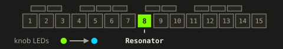

| Knob | Page 1 | Page 2 |
|---|---|---|
| 1 | Pitch: 22 Hz to 880 Hz (default 110 Hz) | — |
| 2 | Feedback: up to 98% (default 0, off) | Stereo: the right channel up to 12 semitones higher (default off) |
| 3 | Tone: the loop's lowpass, 1 kHz to 15 kHz (default 6.6 kHz) | Band: what goes into the ringing loop |
| 4 | Env mod: the feedback rises with the input's level, so loud notes ring longer (default off; the SP-404MK2's ENV MOD) | Level of what it rings |

- **With other effects:** on its own it's a comb on the incoming signal. With the inserts inside
  the loop on, the ringing goes through them on every trip: through the shifter it spirals,
  through the crusher it turns grainy, the filter shapes it the way a filter in a dub delay's
  feedback does, and the phaser sweeps through it. With the freezer on, it rings the repeats;
  with the slicer on, the ringing is chopped into bursts.
- **Feedback inside the loop:** an insert in the loop with feedback or resonance of its own
  (the phaser, the flanger, the filter's resonance) raises the loop's gain. The phaser's
  peaks between its notches are about +4 dB at its default feedback and +16 dB at 85%, so
  with it on, the ringing runs away (and the soft clipper holds it) already at a low
  resonator feedback. Nothing evens that out by itself: for less, turn the inserts' feedback
  or the resonator's down.
- The loop holds a soft clipper, a lowpass (Tone) and a 50 Hz highpass, so it saturates
  rather than runs away, whatever is inside it. It turns the input down as the feedback goes
  up, by half at the most.
- **Level is inside the loop:** what it rings goes round again at page 2's Level, so Level
  also sets how long it rings. Turned down, the ringing dies sooner; above 0 dB it can ring on
  by itself already with little feedback, held by the soft clipper. At the bottom the ringing
  is gone, but the input is still turned down with the feedback.
- LEDs: the key is lime; the knobs go lime to light blue.

## Slicer
<!-- summary: Chops the sound in 16th-note patterns, locked to the tempo. -->

White key 9. Chops the sound in 16th-note patterns, locked to the tempo.

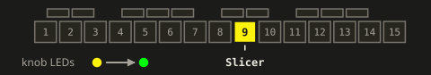

| Knob | Page 1 | Page 2 |
|---|---|---|
| 1 | Pattern: 8 steps of 16ths, `x.......`, `x...x...`, `..x...x.`, `x....x..`, `x..x..x.`, `x.x.x.x.`, `x.x.xx..`, `xxxxxxxx` (default `xxxxxxxx`) | Mix: at less than full, closed steps duck instead of mute (the SP-404MK2's DEPTH) |
| 2 | Decay: 10 ms to 1 s (default 1 s) | Stereo: the left channel plays a pattern up the list, the right one down, 0-7 apart (default off) |
| 3 | Chance: each step flipped at random, up to 90% (default off) | Band |
| 4 | Shuffle: the even steps late, up to two thirds of a 16th, a triplet swing (default straight) | Level |

- **Steps** are 16ths, counted from the [tempo](#tempo-and-transport) like the filter LFO, so
  a pattern is half a bar. Each step that's on starts the envelope again: a 10 ms attack, then
  the decay (knob 2).
- **Pressing the key** starts the envelope again too, at once, the same 10 ms attack and
  decay, whatever step the pattern is on: the sound comes in on the press, and doesn't drop
  out before the next step that's on.
- LEDs: the key is yellow; the knobs go yellow to green.

## Wow & flutter
<!-- summary: Tape warble: a slow drift in pitch and the fast wobble of a capstan, with worn tape's dropouts. -->

White key 10. Tape warble: a slow drift in pitch and the fast wobble of a capstan, with worn
tape's dropouts.

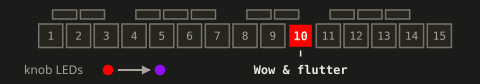

| Knob | Page 1 | Page 2 |
|---|---|---|
| 1 | Wow: how often the pitch drifts and how much of it you hear, together (default off; TAPE's warble) | Mix |
| 2 | Flutter: a fast, shallow wobble, up to 1.4% of pitch; real tape's 0.1-0.5% is the lower half (default off) | Stereo: the right channel drifts on its own and wobbles out of step (default off) |
| 3 | Tone, lowpass 200 Hz to open (default open) | Band |
| 4 | Age: worn tape's dropouts, the level dipping at random, more often, deeper and longer as you turn it up (default none) | Level |

- **Wow:** a short delay (2-20 ms) that now and then heads for a new length at a random
  speed, so the pitch drifts like a worn tape's. The knob sets both how often (0.1 to 30
  times a second) and how much of the drift you hear: around the middle the drifting copy
  blends with the untouched sound into a chorus, at the top you hear only the drift.
- **Flutter** is two fast wobbles, at 7.3 Hz and 11.7 Hz, like a capstan's and a pinch
  roller's. It brings the effect in over the first quarter of its knob, so it works without
  the wow.
- **Age on its own:** with Wow and Flutter at 0, Age's first quarter brings in a copy about
  11 ms late (where the wow last left it, once you've used it), blended with the untouched
  sound: a hollow, comb-like colour at low Age. From a quarter on you hear only the copy, just
  as late, with its dropouts.
- **Tone** darkens what comes off the tape, not the untouched sound.
- LEDs: the key is red; the knobs go red to purple.

## Tape stop
<!-- summary: Winds the tape down to a standstill while you hold the key, and spins it back up when you let go. -->

White key 11. Winds the tape down to a standstill while you hold the key, and spins it back
up when you let go.

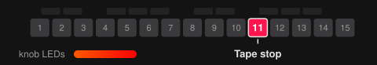

| Knob | Page 1 | Page 2 |
|---|---|---|
| 1 | Stop time: 1/16, 1/8, 1/4, 1/2, 1 bar, 2 bars (default 1/2) | Mix |
| 2 | Spin-up time on release: off, 1/16, 1/8, 1/4, 1/2, 1 bar (default 1/4) | Darken: the highs fall away as the tape slows (default off) |
| 3 | Curve: linear to a brake, fast at first then dragging (default linear) | Band |
| 4 | Depth: how far it slows, from a full stop at the top (default) down to half speed (the SP-404MK2 Stopper's DEPTH) | Level |

- **Press:** the tape slows to a standstill over the stop time and the pitch falls with it.
  Below 5% of speed the level fades too, as on a real machine, and while you hold the key it
  stays stopped and silent.
- **Release:** the tape spins back up from the incoming signal over the spin-up time, then
  crossfades (15 ms) back to the incoming signal once it's at speed. A spin-up has to start
  from the incoming signal: a tape slower than real time falls behind, so it can't catch up by
  itself. With the spin-up off, it goes straight back.
- **Release halfway down** spins up from that speed. **Press while it spins up** and it
  slows again from there.
- **Curve:** linear slows the tape evenly. Turned up, it brakes: fast at first, then a long
  drag at the bottom. The spin-up mirrors it, a motor's quick start and slow settle.
- The times follow the [tempo](#tempo-and-transport), taken when the stop or spin-up starts,
  so a stop pressed on a beat lands on a beat.
- It comes before the delay and reverb, so their tails ring on while the tape stops. A
  latched tape stop, or a scene that latches one, keeps the input/loop mix silent, and the
  sends get nothing new, until it's unlatched. Page 2's Mix and Level stay on while it spins
  up after you let go.
- LEDs: the key is rose; the knobs go rose to azure.

## Delay
<!-- summary: Echoes in time with the tempo, with random events and shimmer. They keep ringing after you let go. -->

White key 12. Echoes in time with the tempo, with random events and shimmer; they keep ringing
after you let go.

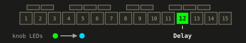

| Knob | Page 1 | Page 2 |
|---|---|---|
| 1 | Division: 1/8, 1/4T, 1/4, 1/2T, 1/4., 1/2, 1/2., 1 bar, 2 bars (default 1/4) | Freeze: the input shut and the echoes held as they are, by degrees, the damping lifted with it; no random events while frozen (default off) |
| 2 | Feedback (default 40%) | Damping: in the middle none; right, every repeat darker (a high cut); left, every repeat thinner (a low cut) |
| 3 | Random: left of centre retrigger / reverse / pitch events, right octave-up shimmer with random pan, centre off (default off) | Band: what goes in, right a low cut, left a high cut |
| 4 | Ducking: the echoes duck under what you play, back up when it stops (default off) | Level: the echoes' level, off at the bottom, then -36 dB to +12 dB (default 0 dB, at 3/4) |

- **Tempo:** the [tempo](#tempo-and-transport): with a loop, its exact tempo, so the echoes
  stay on its beats; otherwise rounded to whole BPM. Limited to 50-300 BPM so 2 bars fit the
  10 s buffer.
- **Random events** are rolled on every 8th note; the knob's distance from centre is the
  chance. The 8th notes are counted from the loop's start. Without a loop, only the clock's
  tempo is used, not MIDI Start / Song Position, so they're counted from when the clock locked
  (or from power-on, or the last tap, without clock), not from the DAW's beat 1. Echo spacing
  is unaffected.
- **Fixed stereo spread:** the left echoes come 20 ms after their beat, the right ones 10 ms,
  which spreads them. The spread is only on what comes out, not fed back, so every repeat is
  as late as the first and the echoes stay on the beats, however long they ring.
- LEDs: the key is green; division green (short) to light blue (long); random and damping
  blue through white (off) to orange, as every knob with a centre. On page 2, knob 4's LED
  shows the echoes coming back (see [Page 2](#page-2)).

## Reverb
<!-- summary: From a room to a long wash. The tail rings on after you let go. -->

White key 13. From a room to a long wash; the tail rings on after you let go.

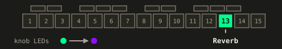

| Knob | Page 1 | Page 2 |
|---|---|---|
| 1 | Decay (default 60%) | Freeze: the input shut and the room held (default off) |
| 2 | Diffusion (default 60%) | Pre-delay: up to 250 ms before the room starts (default none) |
| 3 | Tone: dark to open (default 60%) | Band: what goes in, right a low cut, left a high cut |
| 4 | Ducking: the room ducks under what you play (default off) | Level: the room's level, off at the bottom, then -36 dB to +12 dB (default 0 dB, at 3/4) |

- It gets the inserts' output and the delay's echoes, so the echoes are reverberated while
  both are on.
- Its first diffusion moves a little all the time, as in Mutable Instruments' Clouds and
  Elements, so the same hit rings a little differently each time: a smooth tail rather than a
  metallic one.
- **Freeze** holds the room as it is, highs and all, quiet or loud, for as long as it's on.
  Held for many minutes, a faint hiss rises under it. While frozen, the room moves
  half as much, so a held tone stays clear rather than drifting.
- LEDs: the key is teal; the knobs go teal to purple. On page 2, knob 4's LED shows
  the room coming back (see [Page 2](#page-2)).

## Chaos key
<!-- summary: Makes no sound of its own: drops your latched effects out at random and scrambles the steps of the loop. -->

White key 14. Makes no sound of its own: it drops your latched effects out at random and
scrambles the steps of the loop, on its grid (like the Red Panda Tensor's RAND and the Chase
Bliss Blooper's Scrambler). Its key works like any effect's: hold to play, hold + SHIFT to
latch, part of scenes and morphs. It has no page 2: a knob press does nothing.

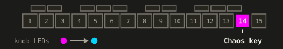

| Knob | Page 1 |
|---|---|
| 1 | FX chance: how often each latched effect drops out of a step, from never to half the steps (default off) |
| 2 | Scramble chance: how often a step of the loop plays from elsewhere in it, from never to every step (default off) |
| 3 | Grid: 1/16, 1/8, 1/4, 1/2, 1 bar, on the effects' tempo (default 1/8) |
| 4 | Random to pattern: left, every step rolled anew; right, a bar rolled once and repeated (default random) |

- **FX gates (knob 1):** the effects you've *latched* drop out of a step and come back on
  the next, at random. An effect you're holding by hand stays on: holding a latched key takes
  it out of chaos's hands while you hold it. With nothing latched, there's nothing to gate.
  The keys of the effects show it: a dropped one dims as if off. Chance only decides when
  they act, never how they sound: their knobs stay yours.
- **Loop scramble (knob 2):** on a random step the loop plays another of its steps, from
  elsewhere in the loop, and on the next step without one it plays in place again. The loop
  itself runs on, so its position, the effects' tempo and its end don't move. Each jump is
  crossfaded (5 ms). Without a loop, or while it's paused, nothing jumps.
- **Grid (knob 3):** how often it rolls the dice, 1/16 to 1 bar, on the effects'
  [tempo](#tempo-and-transport) (the loop, MIDI clock or taps), for both. Its steps are
  counted from the loop's start.
- **Random to pattern (knob 4):** at the left every step is rolled anew; turned right, a
  bar's steps are kept once rolled and only now and then rolled again, so at the right one
  bar repeats and grooves. Each time the key comes on (a press, a latch, a scene), it rolls
  a fresh bar.
- A morph fades it in and out on its two chances.
- Effects that react to coming on do so each time chaos lets them back in: the freezer
  grabs, the tape stop stops, the slicer attacks. A latched tape stop under chaos makes
  random stops.
- LEDs: the key is magenta; the knobs go magenta to light blue.

## Finalizer
<!-- summary: A master section on key 15: input and drive, a 3-band EQ, compression and width, and a limiter that makes it loud. -->

White key 15. A master section on the outputs, after the effects and before VOLUME, so turning
VOLUME doesn't change how hard it works (after Endorphin.es' Golden Master and OTO's BOUM). Its
four modules always run in this order:

Input → EQ → Comp → Width → Drive → Limiter → VOLUME → the safety limiter

EQ, Comp and Width share three bands, split at 300 Hz and 3 kHz. Every module is neutral at its
defaults, and then the finalizer leaves the sound untouched and costs next to nothing. Nothing in
it turns anything up by itself: the compressors have no makeup, and level comes back through
Drive and Loud.

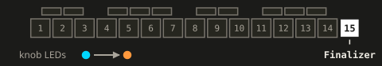

- **Selecting it:** the key selects the finalizer for knobs 1-4, which then turn it the way they
  turn an effect: 1% per detent (more turned fast), SHIFT + turn coarse, SHIFT + press resets. Pressing an FX key
  gives the knobs back to that effect. There's no page 2: a plain knob press does nothing in
  Level, and [mutes a band](#band-mutes) in the other modules.
- **The modules:** with the finalizer selected, hold SHIFT and tap key 15: the knobs show the
  next module, 1 to 4 and round, the key in its colour. Every further SHIFT + key 15 goes on to
  the next, in the same SHIFT hold or a new one. While an effect has the knobs, SHIFT + key 15
  only selects the finalizer, so you never land in another module unseen; tap key 15 twice in
  one SHIFT hold to select it and go on. Only SHIFT held first counts: key 15 and SHIFT pressed
  together, in either order, count as a select, and holding key 15 and then pressing SHIFT never
  switches (that's the [bypass](#finalizer-presets-and-bypass)). It doesn't work on the Loops
  and Cubbi pages.

### Level module

Module 1, white: what goes in, its drive, and how loud it comes out.

| Knob | Function |
|---|---|
| 1 | Input: a clean trim, -12 dB to +12 dB, 3 dB a coarse step (default 0 dB, the centre) |
| 2 | Drive: 0 to +30 dB into a saturation, 0 off (default off) |
| 3 | Type: Boost, Tube, Fuzz (default Boost) |
| 4 | Loud: 0 to +18 dB into the limiter, 3 dB a coarse step, 0 off (default off) |

- **Input (knob 1)** sets the level everything after it works with: more drives the
  compressors and the saturation harder. Its LED is a level meter, as VOLUME's input meter.
  Pink means hotter than the finalizer is set for (Loud's ceiling, the drive's level
  compensation): a source that peaks near AUX's full scale wants Input turned down a few dB
  first, until its peaks no longer reach pink.
- **Drive (knob 2) and Type (knob 3):** Boost is a soft clip, Tube an asymmetric one that adds
  mostly the second harmonic, Fuzz a hard clip. It runs at twice the sample rate, so its
  harmonics don't fold back, with a gentle hi-cut after it. Drive is level-compensated: turning
  it up changes the character, not the level, for a signal at a normal level.
- **Loud (knob 4)** turns the signal up into a limiter with a ceiling of -1 dB, so the loud
  parts stay where they are and the rest comes up. It looks 1 ms ahead, so it's down before a
  peak arrives, and its release adapts: short for a short peak, longer the longer it limits.
  At 0 the limiter is off. While it's on, the output comes 1 ms later; switching it on or off
  crossfades, and [MIDI out](#midi-out)'s clock moves by the same 1 ms, so gear behind FRIZZ
  stays in time with what it hears. Its LED shows the limiter's gain reduction.

### EQ module

Module 2, yellow: the three bands' levels, as on a DJ mixer.

| Knob | Function |
|---|---|
| 1 | Low: the band below 300 Hz, -20 dB to +8 dB (default 0 dB, the centre) |
| 2 | Mid: 300 Hz to 3 kHz, -20 dB to +8 dB (default 0 dB, the centre) |
| 3 | High: above 3 kHz, -20 dB to +8 dB (default 0 dB, the centre) |
| 4 | — |

- **The bands:** Linkwitz-Riley crossovers, 24 dB an octave, that add up flat again: with all
  three at 0 dB, nothing changes but a little phase around the crossovers.
- Their LEDs show each band's level after the EQ, a spectrum in three bars (dim, green,
  yellow, pink as it gets louder).

### Comp module

Module 3, cyan: a compressor on each band, set by its character, all three by one Depth.

| Knob | Function |
|---|---|
| 1 | Low character: Light & fast, Standard & fast, Standard & slow, Parallel, Keep loud, Beat FX (default Standard & slow) |
| 2 | Mid character: as the low band's (default Standard & slow) |
| 3 | High character: as the low band's (default Standard & slow) |
| 4 | Depth: the three bands' thresholds together, from 0 dB down to -30 dB on most characters (below), 0 off (default off) |

- **Depth (knob 4)** is how much the three compress: at 0 they're off, turned up their
  thresholds come down together, by 30 dB at the top. Each starts from its character's own:
  0 dB, but -4 dB for Keep loud and -10 dB for Parallel and Beat FX, so those three compress
  from the first detent.
- **The characters** each set the attack, release, ratio, knee and where the threshold starts; the low band's are 1.5x
  slower, so the bass isn't pumped by its own waveform:
  - **Light & fast:** a gentle ratio, quick to react, for a little glue.
  - **Standard & fast:** a medium ratio, quick: tames peaks.
  - **Standard & slow:** a medium ratio with a slow attack that lets the transients through:
    the classic bus compression.
  - **Parallel:** heavy compression mixed half and half with the band as it was, so it gets
    denser and the transients stay.
  - **Keep loud:** slow and even, it holds the band's level steady.
  - **Beat FX:** fast and hard, it pumps: an effect, not a correction.
- Each band's detector hears both channels, so the image doesn't shift. There's no makeup
  gain: compression only turns down. Bring the level back with Drive or Loud.
- Their LEDs show each band's gain reduction, brighter the deeper it compresses, and knob 4
  its Depth.

### Width module

Module 4, blue: each band's stereo width, which to the right makes even a mono source wide.

| Knob | Function |
|---|---|
| 1 | Low width: mono at the left, as it is at the centre, wider to the right, up to 1.5x, with Space (default the centre) |
| 2 | Mid width: mono at the left, as it is at the centre, wider to the right, up to 2x, with Space (default the centre) |
| 3 | High width: mono at the left, as it is at the centre, wider to the right, up to 2x, with Space (default the centre) |
| 4 | — |

- **Width** scales the difference between the channels (the side): at the left there's none,
  so the band is mono, which keeps the bass solid on a club system; to the right the side is
  turned up.
- **Space** comes in to the right of the centre, more the further right: a copy of the band
  made slightly different goes into the side, so a mono source gets wide too, a synth or a
  voice recorded in mono, without an echo or a wobble. Mid and high get a diffusion of very
  short delays (0.8 to 2.6 ms), heard as room. The low band gets a phase shift between 30 and
  300 Hz, the two channels a quarter turn apart and equally loud, so a kick isn't smeared and
  doesn't lean to a side.
  - **In mono it's gone:** Space goes only into the side, so a mono system, which adds the
    two channels, hears every frequency as loud as before; nothing cancels. With the low
    band's Space the bass's phase turns a little, as a crossover's does.
  - **The channels stay level:** each channel alone wavers a little over the frequency, but
    averaged over a third of an octave, as the ear hears it, the two stay within about 1 dB
    of each other, and the whole about as loud on the left as on the right.
  - **A little louder:** at the right the two channels together are about 1 dB louder, the
    mono sum the same. Nothing turns that back down, as everywhere in the finalizer.
- Their LEDs show each band's correlation, how alike the two channels are: green mono or
  nearly, yellow a normal width, pink very wide, red out of phase, where the band would
  cancel itself on a mono system (watch the low band). A mono source with a band at the right
  reads yellow there: Space alone never turns it pink or red.

### Band mutes

In EQ, Comp and Width a plain press of knob 1, 2 or 3 mutes the low, mid or high band, and
another press brings it back, as the kill switches on a DJ mixer: to take the bass out for a
moment, or to hear one band alone. The mute fades in about 5 ms, without a click. A muted
band's knob LED is nearly dark, dimmer than a band that's only quiet, and flashes as it
toggles. Mutes are for playing: they aren't kept, and power-on or recalling a preset unmutes
all three.

### Finalizer presets and bypass

- **Bypass:** hold key 15, then press SHIFT: the finalizer is switched off, an exact
  pass-through, with a crossfade of about 10 ms (and Loud's 1 ms delay faded out with it); the
  same again switches it on. The key is dim while it's bypassed. It isn't kept: at power-on
  the finalizer is on.
- **Presets:** four, kept on the card with the finalizer, not in the scenes, so the master
  stays as the scenes change. Hold key 15: the keys of scenes 1-4 (the lower G# and A#, the
  upper C# and D#) show the presets, lit where one is stored, the one recalled last white. Holding key 15 changes
  nothing in the sound.
  - **Recall:** hold key 15 and press a scene key: the knobs glide to the preset, and every
    band is unmuted.
  - **Save, copy and delete** go as for [scenes](#save-copy-and-delete): hold key 15 and press
    the upper F#, G# or A#, which starts that mode for the presets rather than the scenes; let
    go of key 15 if you like. The scene keys show the presets in the mode's colour (green,
    blue, red). Pick the preset (for a copy the one to copy, then where to), confirm with
    SHIFT: white for done, red if the card refused. While such a mode waits (or a scene's),
    SHIFT is its confirm, never the bypass, even with key 15 still held.
  - An empty preset's key blinks red when pressed, and the blank scene's key does nothing
    while the presets show. Flipping to the settings page or opening the Loops page ends a
    preset's save, copy or delete.

### Finalizer LEDs and settings

- **Its key** is in the colour of the module the knobs show: Level white, EQ yellow, Comp
  cyan, Width blue. It's never darker than a glow that lets the colour be seen, and it
  pulses brighter with the deepest gain reduction (a band's or the limiter's), at full from
  12 dB; it flashes when pressed, white, or dark while it's already bright. Dim while bypassed.
- **Safety limiter:** after VOLUME, every output has a fixed limiter that keeps it within
  full scale. It's the only thing FRIZZ does to the level by itself, so it shows: key 15
  turns red over everything while it limits, from 1 dB of limiting on and fully red from 3 dB,
  held 0.3 s so a short peak is seen. Red means turn something down: VOLUME, an effect's
  Level, the finalizer's Input or EQ.
  - **Drive and Loud keep it from showing:** each sets the level itself (Drive's level
    compensation holds its output under where red starts, Loud's limiter its own), so with
    either up only an input sent [past the effects](#input-aux-the-mic-or-usb) can still turn
    it red.
  - **Where it starts:** with Drive and Loud at 0 and VOLUME full, about 2 dB over the
    finalizer's 0 dB: an AUX signal peaking above about −5 dBFS at the
    default input gain, or a hot line signal with the Input a few percent up. At VOLUME's 75%
    from power-on it takes more. A loop on its own stays under it, unless the Input, the EQ or
    an effect's Level turns it up.
- **The knob LEDs** are meters while the knobs rest (above, module by module); a knob you turn
  shows its value for a moment, then the meter again: Drive, Type, Loud, the characters and
  Depth from light blue (0%) to orange (100%); the knobs with a centre, Input and the EQ and
  Width bands, blue below it, white on it and orange above.
  Knobs 2 and 3 of Level and knob 4 of Comp always show their values. The output's own meter
  stays VOLUME's.
- **Level:** 0 dB at the input is an AUX signal about 7 dB below full scale, at the default
  input gain.
- **Kept:** the knobs are saved to `FRIZZ/frizz_master.txt` on the card 2 s after the last
  turn, a preset as you confirm it, and they come back at power-on. They're not part of a scene. Without a card, or
  when the card can't be written, the key blinks red 3 times instead (VOLUME does on the Loops
  and Cubbi pages, where key 15 is a loop: for the input gain turned there), and FRIZZ tries
  again 2 s later, up to 3 times; the settings then last until power-off.
- LEDs: the key is white, yellow, cyan or blue, by its module; the knobs go light blue to
  orange, and those with a centre (Input, the EQ and Width bands) blue, white on it, orange.

<!-- part: Scenes and settings -->

## FX scenes
<!-- summary: Your effect settings in 4 scenes, recalled with one key. -->

A scene holds every effect's knob values, on both pages, and whether it's latched. Five dark
keys in the middle are scene keys: lower F#, lower G#, lower A#, upper C# and upper D#.

- **The first (lower F#) is the blank scene:** every effect off and every knob on its
  default. It's always there, a one-press way back to no effects. You can't save over it or
  delete it, but you can copy it into a slot to start a scene from scratch.
- **The other four (lower G#, lower A#, upper C#, upper D#) hold your scenes 1-4.** They're
  saved to the SD card and come back at power-on.

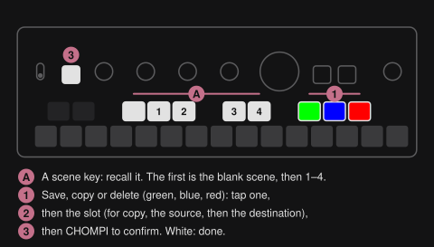

On the play page a press of the lower C# or D# alone does nothing: with SHIFT they open the
[Loops page](#the-loops-page) and the [Cubbi page](#the-cubbi-page). They glow dimly when the
card holds loops (the lower C#) or TAPE's cubbis (the lower D#), in the colour of the first
bank that does.

A saved scene stays as you saved it: changes you make after recalling one are only kept if you
save again.

| Control | Function |
|---|---|
| Scene key | Recall the scene at once: every effect's knobs jump to it, the effects it latched come on and all others are unlatched. FX keys you're holding stay on |
| Scene key of the active scene | Back to the scene as saved, dropping your changes |
| Scene key of an empty slot | Nothing (the key blinks red) |
| Blank scene key | Every effect off, every knob back on its default |

SHIFT + a scene key changes to it in time with the music instead: a morph, a drop or a
crossfade by hand (see [Scene changes in time](#scene-changes-in-time)).

**What a recall does:**

- **The knobs land within about 25 ms** instead of gliding over 100 ms like a turned knob.
  Stepped values (freezer length, slicer pattern, delay division …) switch at once. The
  flanger's stereo can take up to a tenth of a second: its right channel bends back onto
  the left one rather than jumping there, which would click.
- **An effect a recall turns on starts as if you'd pressed its key:** the freezer grabs fresh
  audio, the shifter swoops, the crusher dives, the flanger's sweep restarts, the slicer
  attacks, the tape stops.
- **An effect latched in both scenes keeps running** without restarting. A freeze held
  through the drop stays frozen.
- **Delay and reverb tails ring out** after a scene unlatches them, as they were: a scene
  changes the settings of a delay or reverb that's off only when its key next comes on.
  Turning its knobs meanwhile still moves the tail.
- The input/loop mix, the volumes, the finalizer and the looper aren't part of a
  scene. The finalizer keeps its settings and presets on the card on its own.

### Save, copy and delete

Save, copy and delete are on the last three dark keys, no SHIFT needed. They work like TAPE's
and TEMPO's preset keys, but in the opposite order and their own colours: save first, delete
on the outside, in red as a warning.

| Key | Colour | Function |
|---|---|---|
| Upper F# | green | **Save** the current effect settings into a slot |
| Upper G# | blue | **Copy** one slot into another, without changing the sound |
| Upper A# (the last dark key) | red | **Delete** a slot |

1. **Tap the function's key.** It lights up fully; the scene keys now select slots instead of
   recalling them. The effects and knobs keep working.
   The scene keys you can tap light dimly in the function's colour, the others go dark:
   every slot but the blank one for save, the saved ones for delete, the saved ones and the
   blank one for copy's source.
2. **Tap the slot.** It blinks in the function's colour. For copy, tap the source first
   (it stays lit), then the destination. Tapping a picked slot again unpicks it (for copy,
   the destination first: the source blinks red while one is picked).
3. **Tap the CHOMPI key**, which blinks in the function's colour once there's something to
   confirm. It confirms when you let go; the slot flashes white and the function ends.
   Holding CHOMPI and using another key or knob is SHIFT as ever and doesn't confirm, so
   you can still latch an effect (SHIFT and its key, in either order) or turn a knob
   coarsely before you save.

**To get out without doing anything, tap the function's key again.** Tapping a different
function key switches to that function.

All three speak the same colours: the function's colour shows what will happen, white that
it's done, red that it was refused (a dark slot tapped) or not stored. In delete, whose own
colour is red, a refusal is told apart by its rhythm: 3 quick blinks, where the picked slot
and the CHOMPI key blink steadily. The slot flashes red
instead of white when there's no SD card, or the card couldn't be written: the change works
until power-off but isn't stored. The next save, copy or delete tries the card again, also
one you've put in since.

Outside a function, the scene keys show the slots: dark when empty, dimly white when saved
(the blank one always is),
bright for the scene you recalled or saved last, and pulsing once you've turned a knob or
changed a latch since. The save, copy and delete keys are dimly lit in their colour.

## Scene changes in time
<!-- summary: Morph, drop or crossfade to a scene in time with the music. -->

Changing to a [scene](#fx-scenes) in time with the music: a morph glides to it over 1 to 8
bars, a drop lands it hard on a bar line, and the crossfader puts the morph in your hand.
Each starts with SHIFT + a scene key.

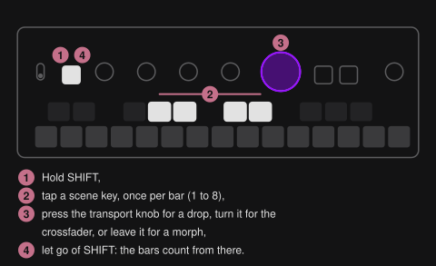

### Timed scene changes

Everything that changes scenes in time with the music is one gesture, in one SHIFT hold:
**SHIFT + a scene key, tapped once per bar** (1 to 8 bars; past 8, the key blinks red), and
then, still holding SHIFT:

| With SHIFT still held | Result |
|---|---|
| nothing: let go of SHIFT | **[Morph](#morphing-to-a-scene)**, gliding over the bars |
| **press** the transport knob | **[Drop](#dropping-to-a-scene)**: the scene lands hard on the last of those bar lines |
| **turn** the transport knob | **[Crossfader](#crossfading-by-hand)**, the morph in your hand |
| a second scene key B | **[Build-up + drop](#dropping-to-a-scene)**: the morph to the first scene over the bars, and B dropping hard at its end |

- **The bars count from letting go of SHIFT**, for a drop too: hold it as long as you like
  and let go in time with the music. Only the scene taps count; pressing the transport knob
  again does nothing.
- **Whatever comes first holds** until you let go of SHIFT: once you've pressed the transport
  knob, turning it does nothing, and the other way round. The crossfader takes over only
  after 2 detents in one direction, the second at least 150 ms old with no press of the knob
  meanwhile, so the knob moving under your finger as you press it doesn't count.
- **One at a time.** A morph, a drop or a build-up runs until it lands; nothing joins it or
  adds to it in a later SHIFT hold:
  - **SHIFT + a blinking scene key** (the one it goes to, or the one it drops to) stops the
    whole sequence where it is: the knobs stay where the glide got to, the scene key pulses
    as edited, and a drop still waiting doesn't happen.
  - **SHIFT + another scene key** stops it where it is and starts a new one from there.
  - **A plain scene key** recalls that scene at once and ends it.
- PLAY isn't part of it: PLAY and SHIFT + PLAY only play and pause.
- Over MIDI, CC 3 and CC 83 follow the same rules (see [Controllers](#controllers)).

### Morphing to a scene

SHIFT + a scene key glides from where you are (the scene you're in, with whatever you've
changed since) to that scene, and lands exactly on a bar line: tap once and it lands at the
end of the bar you let go of SHIFT in; keep holding SHIFT and tap the same key again and it
lands a bar later, and so on, up to 8. A release in the last moment of a bar still lands on that bar's end.

The glide starts when you let go of SHIFT: while you hold it, nothing moves, however long,
and the bar lines don't count yet. On the release it glides to the next bar line from there,
plus one more for each extra tap, so you can hold it as long as you like and let go in time
with the music.

- **An effect on in both scenes:** its knobs glide from their value to the scene's. Stepped
  ones (delay division, slicer pattern, shifter shift, freezer length, filter LFO division …)
  switch on the bar line.
- **An effect the scene turns on fades in:** it comes on when the glide starts with the knobs
  that fade it at their defaults (below), and they glide up to the scene's values. Its other
  knobs take the scene's values at once.
- **An effect the scene turns off fades out:** the same knobs glide back to their defaults (the
  delay's and reverb's Level to off, so their tails fade with it), and on the bar line the
  effect goes off. It stays faded out and takes the scene's settings when its key next comes
  on.
- **The knobs that fade an effect** are the one that brings it in, and on most also page 2's
  Level (from and to 0 dB):
  - the folder and the crusher: all four of page 1 (they colour the sound with every one),
    page 2's stereo and Level;
  - the filter: cutoff, resonance and LFO depth (not the LFO division), and Level;
  - the flanger: amount and Level; the phaser: depth and Level; wow & flutter: wow, flutter,
    age and Level;
  - the resonator: its feedback alone;
  - the delay and reverb: their Level alone, up from off and back down to off, so what comes
    back fades, the echoes or the room;
  - the chaos key: its two chances.

  Mix and Band take the scene's values at once on these.
- **The freezer, shifter and slicer** have no knob that can glide them in (the shifter's
  shift is stepped), so they fade with their page 2 **Mix** instead: one the scene turns off
  glides to dry and goes off on the bar line; the shifter or slicer the scene turns on comes
  on when the glide starts, dry, and its Mix glides up to the scene's. The freezer coming on
  still switches on the bar line, so it grabs on the downbeat: a grab in the middle of a bar
  sounds worse than a hard one on the beat.
- **The tape stop** has nothing to fade with: it switches on the bar line, both ways. Coming
  on, it starts its stop there; going off, it spins up from there.
- **SHIFT + the blank scene** fades every effect out onto the bar line.

The bar lines are the effects' (see [Tempo and transport](#tempo-and-transport)): the loop's bars, counted from its start,
with the loop's end always one too, so a 2-beat loop morphs to its end; without a loop, the
bars of MIDI clock or the tapped tempo, counted from when the clock locked, the last tap or
power-on. A loop playing backwards or paused keeps counting bars.

While it morphs:
- The scene key blinks on the beat. The scene is the active one from the press: saving
  meanwhile saves the scene as it will land.
- The knobs and keys already show the scene. Turning a knob changes where that parameter
  lands. The FX keys work as usual. On an effect waiting to switch on or off (fading in,
  fading out, or waiting for the bar line), latching or unlatching it (SHIFT and its key)
  decides whether it's on once that's done; a plain press decides nothing. With SHIFT still
  held from the scene key, an FX key latches.
- A plain scene key ends the morph and recalls that scene at once (the morph's own key
  jumps straight to the end).
- **SHIFT + its blinking key stops it where it is:** every knob stays at the value the glide
  got to, and an effect still waiting to switch stays as it was, so one fading out stays on,
  unless you pressed its key meanwhile: then it's as you left it. The scene key pulses as
  edited, since the sound is now between two scenes: save it to keep it.
- **SHIFT + another scene key** stops it there too and starts a morph (or drop, crossfade,
  build-up) from where it got to; an empty one blinks red and changes nothing.

### Dropping to a scene

A drop switches to the scene hard, on the downbeat, where a morph glides (like the "drop mode"
of the Neuzeit Instruments Drop). Hold SHIFT, tap a scene key, and press the transport knob
before you let go of SHIFT: the scene lands all at once, as a recall would, but in time, on the
bar line the morph would have landed on. Tap the scene key more than once and it lands a bar
later per extra tap (up to 8), also after the press. The bar lines are the morph's, counted
from letting go of SHIFT: the loop's bars and its end, or those of MIDI clock or the tapped
tempo.

- **Build-up + drop:** hold SHIFT, tap scene key A (once per bar), then scene key B, and let
  go: the morph glides to A over the bars, and B lands hard on the line where it ends. Use it
  to ride a build-up right to the downbeat. A blinks white on the beat, B red. More taps of A
  add bars; B again, another scene key or the transport knob do nothing.
- **On the line:** an effect the scene turns on starts on the line, as after a recall: the
  freezer grabs, the slicer attacks, the tape stops, the shifter swoops. An effect it turns
  off has faded out by the line (it goes off 25 ms before), so nothing of it spills past the
  downbeat. Until then, everything sounds as it was.
- **While it waits,** its scene key blinks red on the beat, and the knobs and keys already
  show the scene, as in a morph. Turning a knob changes where it lands.
- **A plain scene key** meanwhile recalls that scene at once and takes the drop back.
  SHIFT + its red key (or a build-up's white one) in a later SHIFT hold stops it where it
  is: the drop doesn't happen.
- Pressing the transport knob doesn't touch the loop's speed while it makes a drop.
- Once the transport knob has the morph as the [crossfader](#crossfading-by-hand), a press
  does nothing, and the crossfader can't take a drop.
- Over MIDI, CC 83 drops to a scene (see [Controllers](#controllers)).

### Crossfading by hand

A morph at the speed of your hand instead of the bar clock (like the Octatrack's crossfader).
Press SHIFT + a scene key as for a morph, and before you let go of SHIFT, turn the transport
knob. After 2 detents one way, and 150 ms without a press of the knob (which would make it a
drop), the morph is yours, where those detents put it: the scene you're in (with whatever
you've changed) on the left, the one you picked on the right, and everything in between, back
and forth as often as you like. 24 detents take it from one end to the other. It works with or
without a loop, and the bar lines don't count while you hold it.

- **What fades is what a morph fades:** knobs on both scenes glide with the transport knob;
  an effect only the new scene has fades in as soon as you're off the left end, one only the
  old scene has fades out and goes off at the right end. The freezer, shifter and slicer fade
  with their Mix, as in a morph. What can't fade switches in the middle, either way: stepped
  knobs (delay division, slicer pattern, shifter shift …), the tape stop, and the freezer
  coming on, which grabs there.
- **Let go of SHIFT** to leave it:
  - **all the way right:** you're in the new scene, as after a recall;
  - **all the way left:** you're back where you started, the scene you were in as it was
    (pulsing if you had changed it, steady if not);
  - **in between:** it stays where it is, as stopping a morph leaves it: the knobs where the
    fade got to, the new scene's key pulsing as edited. Save it to keep it.
- **LEDs:** the two scene keys light in their mix, one brighter as the other dims, and the
  transport LEDs show the position in white instead of the speed: the left one for the old
  scene, the right one for the new.
- Letting go without turning is a plain morph: it glides to the bar line. While you
  hold a morph, SHIFT + turn crossfades instead of stepping the speed in 5ths and octaves;
  once you've let go, the transport knob is back to speed and scrub at once.
- Over MIDI, CC 80 is the crossfader (see [Controllers](#controllers)).
- On the Loops page, a white key in the same hold puts two loops under the crossfader too
  (see [Two loops on the crossfader](#two-loops-on-the-crossfader)).

## Settings page

<!-- summary: MIDI, the clock, the input and the LEDs, set once per setup. -->

With the mode switch **up**, the keys set up MIDI, the input and the LEDs. The loop, the
effects and MIDI play on meanwhile; switch back down to play.

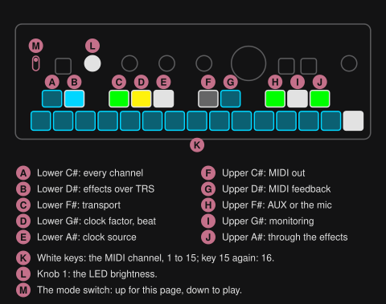

Each key sets one thing on its press. The white keys pick the MIDI channel; the dark keys
and knob 1 set the rest:

| Control | Setting | Colour |
|---|---|---|
| White keys 1 to 14 | [MIDI channel](#channels) 1 to 14; the one in force lit, the others dim | light blue |
| White key 15 | Channel 15; pressed again 16, again 15, and so on (default 16) | light blue for 15, white for 16, dim for neither |
| Lower C# | MIDI on every channel: lit when on. It only switches it on; a channel key switches it off | light blue |
| Lower D# | [Effect channels over TRS](#channels): on (lit, default) / off (dim). Over USB they always count | light blue |
| Lower F# | [MIDI transport following](#start-and-stop): on (lit) / off (dim) | green |
| Lower G# | [Clock factor](#clock-factor), each press the next: as sent (default), double, half. It also shows the [beat](#tempo-and-transport): lit for the first half of every beat, dim for the second | yellow (as sent), red (double), light blue (half) |
| Lower A# | [Clock source](#clock-source), each press the next: Auto (default), TRS, USB, internal | white (Auto), orange (TRS), blue (USB), pink (internal) |
| Upper C# | [MIDI out](#midi-out), each press the next: off (default), TRS, TRS and USB | dim (off), orange (TRS), white (TRS and USB) |
| Upper D# | [MIDI feedback](#midi-feedback): on (lit) / off (dim, default) | light blue |
| Upper F# | [The input's source](#input-aux-the-mic-or-usb), each press the next: AUX, the built-in mic, USB (a computer). Not saved: AUX's jack picks AUX or the mic again when a cable goes in or out, but leaves USB | green (AUX), magenta (mic), blue (USB; dim while [USB audio](#usb-audio) is off) |
| SHIFT + upper F# | With AUX or the mic: [mono input](#mono-input), mono / stereo (default). With USB: [USB audio](#usb-audio) on (default) / off. While you hold SHIFT, the upper F# shows it: lit when on, dim when off. With the card lent to the computer, USB audio can't switch: it blinks red 3 times | white; red (refused) |
| Upper G# | [The source's monitoring](#input-aux-the-mic-or-usb), on the outputs: on (lit) / off (dim). AUX and USB on, the mic off at first | white |
| Upper A# | [The source's effects](#input-aux-the-mic-or-usb): through them (default) / past them and the finalizer. Dark while the source isn't monitored: pressed then, it blinks red 3 times and changes nothing | green (through), white (past) |
| Knob 1 | [LED brightness](#led-brightness): turned, 5% a detent from 25% to 100% (default); SHIFT + turn the next of 25, 50, 75, 100%; SHIFT + press 100% | its LED white, as bright as the LEDs are |

The dark keys are grouped by topic: the lower ones are MIDI in, the upper ones MIDI out and
the input.

- **The beat on the lower G#** is the tempo the effects follow right now (see [Tempo and transport](#tempo-and-transport)): with a
  loop, the loop's at its speed; otherwise the MIDI clock's; otherwise the last tempo, each
  with the clock factor applied (a loop, a clock or a tapped tempo of 120 at double beats at
  240). It's there to see the
  tempo, not to play to: it can be a little late, up to a few hundredths of a second. The
  play page shows it on PLAY too (see [Looper](#looper)).

- **VOLUME** works here as on the play page, on two of its pages: turned, page 1 sets the
  output gain, page 2 the input gain (of the input you hear); a press picks the other page.
  There's no page 3 and no input/loop mix here: SHIFT + turn does nothing. Coming from
  VOLUME's page 3 on the play page, it's on page 1.
- **VOLUME's LED** shows the battery, but for 2 s after you turn or press VOLUME, when it
  shows its page as on the play page: white while the charging cable is in,
  green above 3.3 V, yellow below. Below 3 V, on any page, the low-battery countdown starts
  ([Power and battery](#power-and-battery)) and VOLUME's LED flashes red. Pull
  the cable and it shows the battery's colour within a few seconds; after that the level is
  read every 30 s.
- The transport LEDs are purple, so the page can't be mistaken for the play page.
- **SHIFT + VOLUME, held 2 s:** hold SHIFT and press and hold the VOLUME knob, in either
  order; after 2 s it writes a [bug report](#bug-reports), once per hold. CHOMPI lights white
  while you hold it, as on the play page. SHIFT held from the play page, the switch flipped
  up with it held, counts here as for every SHIFT combination, for SHIFT + LOOP's hold too.
- **SHIFT + LOOP, held 2 s:** lends the card to a computer on USB as a drive, LOOP blue while
  it's lent (3 red blinks if it can't); the same again takes it back (see
  [The card as a USB drive](#the-card-as-a-usb-drive)).
- Otherwise knobs 2-4 (their LEDs dark), CHOMPI (but as SHIFT), PLAY and LOOP (but SHIFT +
  LOOP held) do nothing here.
- A key you're holding when you flip the switch stays where it went down until you let go:
  an effect you hold keeps going, and the key doesn't also change a setting. The same the
  other way round.
- Flipping up ends a [save, copy or delete](#save-copy-and-delete) function: nothing is
  saved, copied or deleted, and you're out of the function when you flip back down.
- The low-battery warning dims with the LEDs too.
- Every setting but the source itself (AUX, the mic or USB) is saved on the card with the
  finalizer, 2 s after the last change, so it comes back at power-on: each source's
  monitoring and effects, all three input gains and USB audio too. None is part of a scene. Without a card, or when the
  card can't be written, the key you changed last (or knob 1's LED, for the brightness) blinks
  red 3 times, and FRIZZ tries again 2 s later, up to 3 times; the setting then lasts until
  power-off.

### LED brightness

Knob 1 on the settings page sets how bright every LED is, for a dark stage: turned, 5% a
detent, from 25% to 100%; SHIFT + turn goes to the next of 25, 50, 75 and 100%; SHIFT +
press is back to 100%. Its own LED is white and dims with all the others, so it shows where
you are. The dim colours keep their hue, and nothing lit at 100% goes dark; below 25% they
would. Keys that are off dim less than the rest, so neighbouring keys' colours (keys 1 and 2,
4 and 5) and the CHOMPI key's bank colour on the Loops and Cubbi pages stay apart: at 25% an
off key is about half as bright as a lit one. Saved 2 s after the last turn.

## Input: AUX, the mic or USB

<!-- summary: AUX, the mic or a computer, through the effects or past them. -->

With a cable in AUX, you hear AUX through the effects. With no cable, the input is CHOMPI's
built-in microphone, as on TAPE and TEMPO: the looper can record it, but it stays off the
outputs, so a loudspeaker near CHOMPI can't feed it back. The third source is a computer on
USB: what it plays to FRIZZ as a sound card (see [USB audio](#usb-audio)). Three keys on the
[settings page](#settings-page) change this, left to right the source, whether you hear it,
then how:
the upper F# picks **the source**, the upper G# switches its **monitoring**, on the outputs or
not, and the upper A# sends it **through the effects** or past them.


- **Upper F#, the source:** AUX (green), the mic (magenta) or USB (blue), each press the next.
  AUX's jack picks between AUX and the mic: with a cable plugged in, it's AUX; pull it out and
  it's the mic; plug one in and it's AUX again. At power-on the jack decides the same way. The
  upper F# picks another by hand, until a cable next goes in or out of AUX; USB, once picked,
  stays when a cable goes in or out. A jack change while recording just switches. The source
  isn't saved.
- **Upper G#, monitoring:** the source on the outputs or not, lit when it is, as monitoring in
  a DAW: the looper records the source either way. Unmonitored, you can still record it and
  hear it alone on the headphones' feed, without it on the master.
- **Upper A#, the effects:** through them, through the input/loop mix, the effects and the
  finalizer; or **past them**, past the effects and the finalizer, at the input/loop
  mix's input share, straight to VOLUME and the safety limiter. Lit green for through, white
  for past; dark while the source isn't monitored, when it doesn't matter (pressed then, it
  blinks red 3 times and changes nothing; its setting is kept for when it's monitored again).

The upper G# and A# are **each source's own**: they show and set the source heard now, and
switching the source (the upper F# or the jack) brings up the other's. All three sources' are
saved. Out of the box AUX and USB are monitored through the effects, and the mic is through
the effects but **not monitored**.

**The looper always records the source as it is**, whatever the upper G# and A# say; the loop
always goes through the effects. The input/loop mix (SHIFT + VOLUME) moves by itself for
either source: to the loop alone when a recording finishes and back to the input alone when
the loop is erased, so a loop isn't heard twice; with the source not monitored, its input share is
silent. The headphone feed (VOLUME's page 3) too: turned left, the input alone.

What you hear, by the input/loop mix's position (SHIFT + VOLUME), as a reference. The
headphones carry the same as the line out with the feed at the master, the input alone with
it turned left, a blend between:

| Upper F# source | Upper G# monitoring | Upper A# effects | Line, mix at "input" (no loop, or after an erase) | Line, mix in the middle | Line, mix at "loop" (after a recording) | Headphones, feed left |
|---|---|---|---|---|---|---|
| AUX | on | through | AUX through the effects + finalizer | AUX and the loop together through the effects + finalizer | the loop through the effects + finalizer | AUX pure |
| AUX | on | past | AUX pure (VOLUME and the limiter only) | AUX pure + the loop through the effects | the loop through the effects | AUX pure |
| AUX | off | – | silence (delay/reverb tails at most) | the loop alone through the effects, at its share | the loop through the effects | AUX pure |
| mic | on ⚠ | through | the mic through the effects + finalizer | the mic and the loop together through the effects | the loop through the effects | mic pure |
| mic | on ⚠ | past | the mic pure | the mic pure + the loop through the effects | the loop through the effects | mic pure |
| mic | off | – | silence | the loop alone through the effects, at its share | the loop through the effects | mic pure |
| USB | on | through | the computer through the effects + finalizer | the computer and the loop together through the effects + finalizer | the loop through the effects + finalizer | the computer pure |
| USB | on | past | the computer pure | the computer pure + the loop through the effects | the loop through the effects | the computer pure |
| USB | off | – | silence | the loop alone through the effects, at its share | the loop through the effects | the computer pure |

- In the column heads, "mix" is the input/loop mix.
- "–": the upper A# doesn't matter while the source isn't monitored (its key dark, its value kept).
- The looper records the source as it is in every row.

**⚠ Monitoring the mic feeds back** through a loudspeaker near CHOMPI, through the effects more
so (a delay or a reverb repeats it). Switch its monitoring on with headphones, or with the speakers well
away and down. Mind the headphones' volume too: turned up near CHOMPI, they can feed back
into the mic as well.

**AUX past the effects** is for a source that should stay as it is while you play the loop
through the effects: a drum machine, a mastered song. Record it, and the input/loop mix goes
to the loop alone as always; turn it to the middle to play an existing loop through the
effects next to the device. **AUX unmonitored** records AUX without hearing it on the master (on
the headphones' feed, turned left, you still do).

**The mic** is mono, the same on both sides. It also hears CHOMPI's own keys and knobs: with
the mic monitored through the effects, a delay or a reverb rings out their clicks. For clean
takes use AUX; with the mic, record the loop first, then switch its monitoring off before you
play the effects over it. FRIZZ treats it as TAPE does: 5× the input gain
(AUX gets 3×) and a highpass at about 150 Hz; its DC is taken out as AUX's is, from about
8 Hz down. VOLUME's page 2 sets the
input gain of the source heard: each source has its own, saved. A
switch of the source, of the upper G# or of the upper A# fades over 5 ms, so it doesn't
click; the source going out fades out of the outputs while the one coming in fades in, so a
source that isn't monitored is never heard, not even during a switch.

**USB** is stereo, as AUX is, and comes in at the level AUX would have with the same signal at
its jack, but without mono. While the computer plays nothing (or [USB audio](#usb-audio) is
off) it's silent.

Over MIDI, CC 84 picks the source, CC 116 sets its effects and CC 117 its monitoring (see
[Controllers](#controllers)), without saving them.

### Mono input

Mono is for a mono (TS) cable, such as one from a Lyra-8 or a guitar pedal: the plug grounds
the right channel, so in stereo the source is heard on the left only. In mono the left channel
feeds both sides, and the effects' stereo knobs spread it from there. On the [settings
page](#settings-page), SHIFT + upper F# toggles it; while you hold SHIFT, the upper F# shows it
(lit when mono). It's for AUX only: the mic is mono anyway, and plays on both sides either way, and USB brings
its own channels. With USB the source, SHIFT + upper F# switches [USB audio](#usb-audio)
instead.

## USB audio

<!-- summary: FRIZZ as a USB sound card: record its master, play into it. -->

On a computer's USB, FRIZZ is a **sound card**, called FrizZ, alongside its MIDI: 2 channels
each way, 48 kHz, 24 bit, as USB Audio Class 1, which macOS, Windows, Linux and iPadOS know
without a driver.

- **From FRIZZ to the computer:** the master as it is before VOLUME, so a recording doesn't
  change with the knob: the line out's signal at full VOLUME, before the safety limiter. Pick
  FrizZ as an input in the DAW or the recording app.
- **From the computer to FRIZZ:** the [input](#input-aux-the-mic-or-usb)'s third source, USB. Pick
  FrizZ as an output, and on the [settings page](#settings-page) USB with the upper F# (blue).
  Like AUX it has its own input gain, monitoring and effects, and the looper records it.

**Set the computer (or the DAW) to 48 kHz for the best quality.** FRIZZ runs at 48 kHz only; a
computer set to another rate converts on its side, which costs it a little quality and
latency. The computer follows FRIZZ's own clock, both ways, so nothing drifts or clicks over a
long take.

**USB audio on or off:** on the settings page, with USB the source, SHIFT + upper F# switches
it; while you hold SHIFT, the upper F# shows it (lit on, dim off). It's on out of the box, and
saved. Switching it, FRIZZ leaves USB for a moment and comes back with the other setup: MIDI
over USB is gone for about a second, then back, and a [Companion](#the-companion) upload
running ends. Off, FRIZZ is MIDI and the [card drive](#the-card-as-a-usb-drive) alone: for a
computer that has trouble with the sound card, or that you don't want to offer one. With USB audio off, USB stays a source you
can pick, dimly blue, and silent. While the card is lent to the computer, USB audio can't be
switched: the upper F# blinks red 3 times.

## Card and files

<!-- summary: What FRIZZ keeps on the SD card, and how to edit it. -->

FRIZZ keeps what it saves on the SD card, in a folder `FRIZZ`, as text files, and plays your
loops from there. Leave the card in.

| File | Holds | Written |
|---|---|---|
| `FRIZZ/frizz_scenes.txt` | The 4 [FX scenes](#fx-scenes) | When you save, copy or delete a scene |
| `FRIZZ/frizz_master.txt` | The [finalizer](#finalizer) and its presets, and the [settings page](#settings-page): the MIDI settings, the LEDs' brightness, AUX mono, USB audio, and for AUX, the mic and USB each their input gain, monitoring and effects | 2 s after the last change |
| `FRIZZ/frizz_scenes.bak`, `frizz_master.bak` | A file FRIZZ couldn't read, or the computer's version that FRIZZ's own replaced ([The card as a USB drive](#the-card-as-a-usb-drive)) | When FRIZZ writes its own in that file's place: at the next save, or when it takes the card back |
| `FRIZZ/frizz_scenes.tmp`, `frizz_master.tmp` | A save on its way, renamed into place when it's whole | During a save; one a power cut left is finished at power-on |
| `FRIZZ/bug-1.txt`, `bug-2.txt` … | [Bug reports](#bug-reports) | When you ask for one |
| `FRIZZ/a1.wav` … `h15.wav` | Your [loops](#loops-on-the-card) | Only by the [Companion](#the-companion), as it uploads, moves or deletes them |
| `FRIZZ/xfer.tmp` | A Companion upload under way, renamed to its slot when it's whole | During an upload; one left over is deleted at power-on |
| `FRIZZ/a1-b2.swp` and the like | A Companion swap under way | During a swap; one cut short is put right when FRIZZ next looks for the loops |
| `TAPE/cubbi_a1.wav` … `cubbi_e15.wav` (or in the card's root) | TAPE's recordings, on the [Cubbi page](#the-cubbi-page) | Never: FRIZZ only reads them |

### Scenes and settings on the card

The scenes live in `FRIZZ/frizz_scenes.txt` on the card, one line per effect, keyed by its
name. FRIZZ creates the folder on its first start; after that the scene file is written only
when you save, copy or delete, never on a recall. Saving takes a moment in which the LEDs may pause. A scene file FRIZZ can't
read (from another version, or edited into something else) starts it with no scenes but
isn't lost: the first save moves it to `frizz_scenes.bak`.

If FRIZZ couldn't read the card at power-on, every save flashes red until you switch off and
on again, so the scenes on the card aren't replaced by the session's.

`frizz_master.txt` holds one setting per line, which can be edited on a computer too:

| Line | Setting | Values |
|---|---|---|
| `midi_channel` | The global [MIDI channel](#channels) | 1-16, 0 every channel |
| `midi_block_trs` | [Effect channels over TRS](#channels) | 1 on, 0 off |
| `midi_transport` | [MIDI transport following](#start-and-stop) | 1 on, 0 off |
| `clock_factor` | [Clock factor](#clock-factor) | 100 as sent, 200 double, 50 half |
| `clock_source` | [Clock source](#clock-source) | 0 Auto, 1 TRS, 2 USB, 3 internal |
| `midi_out` | [MIDI out](#midi-out) | 0 off, 1 TRS, 2 TRS and USB |
| `midi_feedback` | [MIDI feedback](#midi-feedback) | 1 on, 0 off |
| `led_brightness` | [LED brightness](#led-brightness) | 25-100 |
| `mono` | [Mono input](#mono-input) | 1 mono, 0 stereo |
| `gain_aux`, `gain_mic`, `gain_usb` | Each source's input gain ([VOLUME knob](#volume-knob)) | 0-100 |
| `aux_dry`, `mic_dry`, `usb_dry` | Each source's effects ([Input: AUX, the mic or USB](#input-aux-the-mic-or-usb)) | 0 through them, 1 past them |
| `aux_live`, `mic_live`, `usb_live` | Each source's monitoring | 1 on, 0 off |
| `usb_audio` | [USB audio](#usb-audio) | 1 on, 0 off |
| `finalizer` | The [finalizer](#finalizer)'s knobs, Level's four, EQ's three, Comp's four, Width's three | 0-1000000 each |
| `finalizer_preset1` ... `4` | Its [presets](#finalizer-presets-and-bypass), each as `finalizer`, only those stored | |

A line FRIZZ doesn't know is skipped, a setting left out or out of its range keeps its
default, and a word where a number belongs makes the whole file unreadable: FRIZZ then starts
with every setting at its default and keeps the file as `frizz_master.bak`. Edit the files
with the card taken out, in the launcher's [USB storage mode](INSTALL.md#usb-storage-mode), or
on the card [lent as a USB drive](#the-card-as-a-usb-drive), which FRIZZ reads again when it
takes the card back.

### The card as a USB drive

To get files on or off the card (loops, scenes, bug reports) while FRIZZ runs, lend it to the
computer: on the [settings page](#settings-page), with a computer on USB, hold **SHIFT + LOOP
for 2 s**. LOOP lights blue there while the card is lent, and the computer finds the drive
"FrizZ card" with the card on it (the drive is there all the time, empty while the card isn't
lent). The loop and the effects play on meanwhile.

- **To take it back:** eject the drive on the computer, unplug the cable, or hold SHIFT + LOOP
  for 2 s again on the settings page; a computer going to sleep takes it back too, and so does
  a restart over MIDI (the launcher's), before FRIZZ restarts. FRIZZ then looks for the loops
  again (the Loops page shows what's there now).
- **Scenes and settings edited on the computer come in:** taken back, FRIZZ reads
  `frizz_scenes.txt` and `frizz_master.txt` again if the computer changed them, as at power-on
  ([Scenes and settings on the card](#scenes-and-settings-on-the-card)). A file the computer
  left as it was changes nothing.
  - The settings apply at once. The input gains and the finalizer's knobs glide there as when
    you turn them, and `usb_audio` switched takes FRIZZ off USB and back on as the settings
    page does. What MIDI set without the card (an input gain by CC, say) goes to the file's
    value, as after a restart.
  - The scenes come in for their next recall: what plays stays as it is. If the scene that
    plays changed, its key pulses as edited, as after you turn a knob; if the computer deleted
    it, what plays stays and no scene key is lit for it, as after a delete.
- **If you changed them on FRIZZ meanwhile, FRIZZ's wins**, file by file: a scene saved, copied
  or deleted while the card was lent, or a setting changed (or still in its 2 s before it's
  saved) when you take the card back. FRIZZ then writes its own over the computer's, and keeps
  the computer's as `frizz_scenes.bak` or `frizz_master.bak`.
- **A file the computer left unreadable** changes nothing in FRIZZ: it writes its own at once
  and keeps the computer's as the `.bak`. One the computer deleted changes nothing either, and
  FRIZZ's next save writes it again.
- **While it's lent, FRIZZ leaves the card alone:** saving a scene or a setting waits until
  it's back, a loop can't be loaded from it, a bug report can't be written, and a
  [Companion](#the-companion) upload running stops: the page waits and sends that loop again
  from its start once the card is back. A loop from the card you played just before
  is usually still in memory and switches at once; one that has to be loaded waits until the
  card is back. Only the settings page shows it (LOOP blue); on the play page FRIZZ plays as
  always.
- **Refused** (LOOP blinks red 3 times): without a computer on USB, while LOOP records, while a
  loop loads or FRIZZ looks for the loops (a few seconds after power-on, and after the card
  comes back), or while FRIZZ writes the card.

Eject the drive on the computer before you take the card back by the gesture, as you would any
drive, so the computer has written everything.

### Taking the card out

Take the card out or swap it only while the CHOMPI is off: a card pulled while FRIZZ runs
isn't looked after. To get files on or off it (loops, scenes, bug reports), lend it to the computer
as a [USB drive](#the-card-as-a-usb-drive), or use the multi-firmware launcher's [USB storage
mode](INSTALL.md#usb-storage-mode), instead of taking it out. On a card
with several firmwares, FRIZZ keeps its `FRIZZ` folder apart from the others' files.

### Files from an older FRIZZ

FRIZZ reads the scene and settings files of earlier versions and carries their values over
to where the knobs and keys are now; the [changelog](CHANGELOG.md) says what changed with
each version.

<!-- part: Reference -->

## Key combinations

<!-- summary: Every gesture in one table, with where it's explained. -->

Every gesture on one page; each row links to where it's explained. SHIFT is holding CHOMPI.


### On the play page

| Gesture | Does | See |
|---|---|---|
| LOOP | Record; stop and play; erase | [Looper](#looper) |
| PLAY | Play / pause, when you let go | [Looper](#looper) |
| Hold PLAY, press LOOP | No loop: a quantized recording. A loop playing: erase at its end | [Looper](#looper) |
| PLAY while an erase waits | Takes the erase back | [Looper](#looper) |
| SHIFT + LOOP | Tap tempo | [Tap tempo](#tap-tempo) |
| SHIFT + PLAY | As PLAY | [Looper](#looper) |
| Turn the transport knob | Speed in semitones; paused, a scrub | [Transport knob](#transport-knob) |
| SHIFT + turn the transport knob | Speed in 5ths and octaves | [Transport knob](#transport-knob) |
| Press the transport knob | Back to 1× forward | [Transport knob](#transport-knob) |
| Turn VOLUME | Page 1 output gain, page 2 input gain, page 3 the headphone feed | [VOLUME knob](#volume-knob) |
| Press VOLUME | The next page | [VOLUME knob](#volume-knob) |
| SHIFT + turn VOLUME | Input/loop mix | [VOLUME knob](#volume-knob) |
| SHIFT + press VOLUME | The input/loop mix back to the loop alone, or the input alone without a loop | [VOLUME knob](#volume-knob) |
| Hold an FX key | The effect on while held | [Playing an effect](#playing-an-effect) |
| Hold FX keys, then SHIFT | Latch them on, or off | [Playing an effect](#playing-an-effect) |
| SHIFT, then FX keys | Latch them on, or off, as well | [Playing an effect](#playing-an-effect) |
| SHIFT + key 7, then key 7 again | The phaser's other mode: the frequency shifter, and back; the latch stays as it was | [Frequency shifter](#frequency-shifter) |
| An FX key on a latched effect | Stays latched; the knobs edit it | [Playing an effect](#playing-an-effect) |
| White key 15 | The finalizer on the knobs | [Finalizer](#finalizer) |
| SHIFT + key 15, the finalizer selected | The finalizer's next module: Level, EQ, Comp, Width | [Finalizer](#finalizer) |
| Hold key 15, then SHIFT | The finalizer bypassed, or on again | [Finalizer presets and bypass](#finalizer-presets-and-bypass) |
| Hold key 15 + a key of scenes 1-4 | Recall a finalizer preset | [Finalizer presets and bypass](#finalizer-presets-and-bypass) |
| Hold key 15 + upper F#, G# or A# | Save, copy or delete a finalizer preset | [Finalizer presets and bypass](#finalizer-presets-and-bypass) |
| Press knob 1-3 on the finalizer's EQ, Comp or Width | Mute that band, or unmute it | [Band mutes](#band-mutes) |
| Turn knobs 1-4 | The selected effect's parameters | [Keys and knobs](#keys-and-knobs) |
| SHIFT + turn knobs 1-4 | Coarse, to the next point of the grid | [Coarse steps](#coarse-steps) |
| SHIFT + press knobs 1-4 | That parameter back to its default | [Playing an effect](#playing-an-effect) |
| Press knobs 1-4 | The effect's page 2, and back to page 1 | [Page 2](#page-2) |
| A scene key | Recall the scene | [FX scenes](#fx-scenes) |
| The active scene's key | Back to the scene as saved | [FX scenes](#fx-scenes) |
| The blank scene's key (lower F#) | Every effect off, every knob on its default | [FX scenes](#fx-scenes) |
| SHIFT + a scene key, let go | Morph to it on the bar line; tap it again for each bar more, up to 8 | [Morphing to a scene](#morphing-to-a-scene) |
| SHIFT + a scene key, press the transport knob | Drop to it on the bar line | [Dropping to a scene](#dropping-to-a-scene) |
| SHIFT + a scene key, turn the transport knob | The crossfader | [Crossfading by hand](#crossfading-by-hand) |
| SHIFT + scene key A, then scene key B | Build-up to A, B dropping at its end | [Dropping to a scene](#dropping-to-a-scene) |
| SHIFT + a blinking scene key | Stop the morph, drop or build-up where it is | [Timed scene changes](#timed-scene-changes) |
| SHIFT + another scene key, while one runs | Stop it there and start the new one from there | [Timed scene changes](#timed-scene-changes) |
| Upper F#, G# or A#, the slot (copy: the source, then the destination), then CHOMPI | Save, copy or delete a scene | [Save, copy and delete](#save-copy-and-delete) |
| The function's key again, the mode switch up, or the Loops or Cubbi page | Out of save, copy or delete, doing nothing | [Save, copy and delete](#save-copy-and-delete) |
| SHIFT + lower C# | The Loops page (the lower C# glows dimly when the card holds loops) | [The Loops page](#the-loops-page) |
| SHIFT + lower D# | The Cubbi page (the lower D# glows dimly when the card holds cubbis) | [The Cubbi page](#the-cubbi-page) |

### On the Loops page

| Gesture | Does | See |
|---|---|---|
| SHIFT + lower C#, or two quick taps of SHIFT | Back to the play page | [The Loops page](#the-loops-page) |
| SHIFT + lower D# | The Cubbi page | [The Cubbi page](#the-cubbi-page) |
| Lower C#, lower D# | The bank before, after (each lit in the colour of that bank) | [The Loops page](#the-loops-page) |
| A white key | Its loop at once, in time | [Switching loops](#switching-loops) |
| SHIFT + a white key, N times | Its loop at the end of the N-th pass | [Switching loops](#switching-loops) |
| SHIFT + a scene key, N times (and the transport or a second scene key), then a white key | The loop with the morph or the drop, N bars on | [A loop with a scene change](#a-loop-with-a-scene-change) |
| SHIFT + a white key, N times, then a scene key (and the transport or a second scene key) | The scene and the loop together at the end of the N-th pass | [A loop with a scene change](#a-loop-with-a-scene-change) |
| SHIFT + a scene key, turn the transport knob, a white key | Both loops on the crossfader; letting go, the nearer side | [Two loops on the crossfader](#two-loops-on-the-crossfader) |
| SHIFT + a blinking key, in a new hold | Cancel the planned switch, and a scene change running | [Switching loops](#switching-loops) |
| Scene keys, the transport knob, PLAY, LOOP, VOLUME | As on the play page | [On the play page](#on-the-play-page) |

### On the Cubbi page

The same keys as on the Loops page, with TAPE's recordings on the white keys. Only the way out
differs:

| Gesture | Does | See |
|---|---|---|
| SHIFT + lower D#, or two quick taps of SHIFT | Back to the play page | [The Cubbi page](#the-cubbi-page) |
| SHIFT + lower C# | The Loops page | [The Loops page](#the-loops-page) |

### On the settings page

| Gesture | Does | See |
|---|---|---|
| White keys 1-15 | The global MIDI channel; white key 15 again for 16 | [Channels](#channels) |
| Lower C# | MIDI on every channel | [Channels](#channels) |
| Lower D# | Effect channels over TRS | [Channels](#channels) |
| Lower F# | MIDI transport following | [Start and Stop](#start-and-stop) |
| Lower G# | Clock factor: as sent, double, half | [Clock factor](#clock-factor) |
| Lower A# | Clock source: Auto, TRS, USB, internal | [Clock source](#clock-source) |
| Upper C# | MIDI out: off, TRS, TRS and USB | [MIDI out](#midi-out) |
| Upper D# | MIDI feedback | [MIDI feedback](#midi-feedback) |
| Upper F# | The input's source: AUX, the mic, USB | [Input: AUX, the mic or USB](#input-aux-the-mic-or-usb) |
| SHIFT + upper F# | AUX mono; with USB the source, USB audio on / off | [Mono input](#mono-input), [USB audio](#usb-audio) |
| Upper G# | The source's monitoring, on the outputs | [Input: AUX, the mic or USB](#input-aux-the-mic-or-usb) |
| Upper A# | The source through the effects, or past them | [Input: AUX, the mic or USB](#input-aux-the-mic-or-usb) |
| Turn knob 1; SHIFT + turn; SHIFT + press | LED brightness; in steps of 25%; back to 100% | [LED brightness](#led-brightness) |
| Turn VOLUME; press | Output gain, input gain | [Settings page](#settings-page) |
| SHIFT + VOLUME held 2 s | A bug report | [Bug reports](#bug-reports) |
| SHIFT + LOOP held 2 s | The card lent to the computer as a USB drive, or taken back | [The card as a USB drive](#the-card-as-a-usb-drive) |

### At power-on

| Gesture | Does | See |
|---|---|---|
| Hold CHOMPI, PLAY and LOOP while switching on | Shipping mode | [Power and battery](#power-and-battery) |

## Power, battery and bug reports

<!-- summary: Low battery, shipping mode, and how to send a bug report. -->

### Power and battery

- **Low battery:** unplugged with the battery nearly empty (below 3 V), the knob, transport,
  CHOMPI, PLAY and LOOP LEDs flash yellow for 15 s and VOLUME's red, on any page, then the
  CHOMPI switches itself off into shipping mode (below): it starts again only once it's
  plugged into power. Plugging in power during those 15 s stops it.
  On a charger too weak to run it with a low battery, it goes dark until it has charged.
- **Battery check:** the [settings page](#settings-page) shows the battery's level on VOLUME's
  LED.
- **Shipping mode:** hold CHOMPI, PLAY and LOOP while switching on: the battery is
  disconnected until the CHOMPI is plugged into power again. Use it to store it for weeks.
- **A restart by itself:** if FRIZZ crashes, or its sound stops for about a second, the
  CHOMPI restarts rather than stay frozen: into the launcher's picker if you use it, or else
  FRIZZ starts again. A loop in RAM is gone, as at power-off. If it happens, note what you
  were doing and report it (see [Troubleshooting](INSTALL.md#troubleshooting)).
- **Hardware test:** FRIZZ has no self-test of its own. To check keys, knobs and LEDs, put the
  stock TAPE or WAVE firmware on a card and hold VOLUME while switching on.

### Bug reports

On the [settings page](#settings-page) (mode switch up), hold SHIFT and
press and hold the VOLUME knob for 2 seconds: FRIZZ writes everything you did since switching
on to the card, as `/FRIZZ/bug-1.txt` (the next one `bug-2.txt`, and so on): every key, knob detent and
mode-switch flip with its time, the MIDI clock's tempo, every MIDI message FRIZZ acted on, and
the scenes and finalizer the card held at power-on. Do it right after something went wrong
(flip the switch up, hold, flip it back down) and send the file with your report:
FRIZZ's developers play it on a virtual CHOMPI on their computer, which then does what yours
did, key for key.

- It's on the settings page so it can't be written by accident while playing.
- While it's written, both transport LEDs blink white; then they blink 3 times, white when
  it's on the card, red when it isn't (no card, a full one, or the card lent to the computer). A long session takes a moment,
  and the keys answer late until it's done; the sound plays on.
- It starts afresh at every start of FRIZZ: after a [restart by itself](#power-and-battery),
  it holds only what came after, so describe what happened before it.
- It doesn't hold the audio you played in, so a problem that depends on the sound itself
  needs a description too, nor scenes sent over MIDI, nor what a computer changed on the card
  while it was lent (it notes when the card was lent and taken back). Dense MIDI automation fills it
  faster: each controller message is an event. It holds about 260,000 events, hours of playing; a session longer
  than that is cut off at the end.
- It doesn't send anything anywhere and costs nothing while you play.

## Appendix: MIDI

<!-- summary: Clock, channels, notes, CCs and FRIZZ's own SysEx. -->

FRIZZ takes MIDI from the TRS MIDI input and over USB (CHOMPI is a USB device, so USB MIDI
comes from a computer or a host), both alike. With [MIDI out](#midi-out) on, it sends its
clock and the loop's Start, Stop and Continue out of the TRS MIDI output, and over USB if you
ask; otherwise it sends nothing over TRS, and over USB it only answers FRIZZ's own queries
(see [Remote control](#remote-control)).

### MIDI clock

Quantized recording, and the effects' tempo while there's no loop, follow MIDI clock
(24 PPQN), from the input the clock source picks. The clock is read on every channel.

### Clock source

The lower A# on the [settings page](#settings-page) picks whose clock counts, each
press the next:

- **Auto** (the default): whichever input ticks first, TRS or
  USB, until it has been silent for 0.5 s; then whichever ticks next.
- **TRS** or **USB**: only that input's clock; the other's is ignored, even while the chosen
  one is silent. A DAW over USB can then play notes and send CCs without its clock getting in
  the way of a sequencer on the jack, or the other way round.
- **Internal**: no MIDI clock at all. The tempo comes from the loop, your taps or the last
  tempo, and tap tempo works while a clock runs; a quantized recording is refused, as without
  a clock.

Switching to a source that leaves out the clock FRIZZ was following lets go of it at once, as
a clock that stops: a quantized recording ends where it is. Notes, controllers, program
changes and FRIZZ's own SysEx come in from both inputs whatever the source; MIDI Start, Stop,
Continue and Song Position come only from the chosen input (see [Start and Stop](#start-and-stop)). It's kept as
`clock_source` in `FRIZZ/frizz_master.txt` (0 Auto, 1 TRS, 2 USB, 3 internal), and
`firmware/remote.py source auto|trs|usb|internal` sets it too.

The [clock factor](#clock-factor) on the [settings page](#settings-page) makes FRIZZ follow
the clock at half its tempo or at double: a DAW at 70 BPM with FRIZZ thinking in 140, or the
other way round. It counts for everything that follows the clock: the bars of a quantized
recording and the effects' tempo. A loop recorded to it keeps those bars when the factor
changes later; the effects then follow the loop at the new factor. Changing it during a
quantized recording ends that recording where it is, as a lost clock does.

### Channels

FRIZZ listens on 16 channels, with two kinds of map:

- **The global channel**, **16** at first: notes (the keys), program changes (scenes, and
  loops from the card after a bank select), the
  looper, the scenes, the gains, every effect's latch, the finalizer, and the knobs of the
  effect in focus. That alone covers FRIZZ from a hardware controller or a TRS chain.
- **The effect channels 1-15**, one per white key, left to right: 1 freezer, 2 shifter,
  3 folder, 4 crusher, 5 filter, 6 flanger, 7 phaser, 8 resonator, 9 slicer, 10 wow & flutter,
  11 tape stop, 12 delay, 13 reverb, 14 chaos key, 15 finalizer. Each has the same
  CCs, so in a DAW one MIDI track per effect has the same automation lanes everywhere.

On the global channel, its own map wins: set it to 5, and channel 5 is the global channel,
with the filter reached through the focus (CC 23 and CC 14-22) and its latch (CC 106). Set to
every channel (0), only the global map counts, on all of them, and the effect channels are off.

Change the global channel on the [settings page](#settings-page), in `FRIZZ/frizz_master.txt`
(`midi_channel 16`; 0 listens on every channel), or from a computer with
`firmware/remote.py channel N`.

**A shared TRS chain:** over USB, FRIZZ is a port of its own. Over TRS, the effect channels
take channels 1-15 of the cable too, so other gear on the same chain that listens or sends on
them reaches FRIZZ's effects. If that gets in the way, switch the effect channels off over TRS
with the settings page's lower D# (`midi_block_trs 0` in `FRIZZ/frizz_master.txt`); over USB
they still count, and the global channel works over both.

### Notes: the keys

A note holds the key it lands on while it's on, as your finger would: an FX key punches its
effect in, a scene key recalls, and so on. The 25 keys are a keyboard from **note 48** (C3,
or C2 in Ableton Live): the white keys from 48 up, the dark keys on the sharps, so the
[scene keys](#fx-scenes) are notes 54 (the blank scene), 56, 58, 61 and 63 (scenes 1-4), and
save, copy and delete 66, 68 and 70. Below them:

| Note | Key |
|---|---|
| 36, 37, 38, 39 | Knob 1, 2, 3, 4 pressed |
| 40 | The transport knob pressed |
| 41 | VOLUME pressed |
| 45 | CHOMPI (SHIFT) |
| 46 | PLAY |
| 47 | LOOP |

- A key held by your hand and by a note is pressed once, and let go when both have let go.
- The velocity doesn't matter; a note on at velocity 0 is a note off.
- All Notes Off (CC 123) or All Sound Off (CC 120) lets go of every key MIDI holds, for a
  note off that went missing.
- So does the computer going away (the cable pulled, the computer asleep) or
  [USB audio](#usb-audio) switching, when FRIZZ leaves the bus for a moment. A note off on any
  channel lets go of a key a note holds, so a key held through a change of the global
  channel still lets go.

### Controllers

**On each effect channel (1-14)**, and on the global channel for the effect in focus:

| CC | Function |
|---|---|
| 14, 15, 16, 17 | Page 1's knobs 1-4, set outright |
| 18, 19, 20, 21 | [Page 2](#page-2)'s knobs 1-4 (Mix or the sends' Freeze, stereo or its own, Band, Level), set outright |
| 22 | Latch: 64 and above on, below off, acting as the value crosses 64 |
| 23 | On the phaser's channel (7) only: its mode, 0-63 the phaser, 64-127 the [frequency shifter](#frequency-shifter). On the other effect channels it does nothing; on the global channel it's the focus |

**On the global channel:**

| CC | Function |
|---|---|
| 14-22 | The effect in focus, as on its own channel |
| 23 | Focus: 1-15, the white key whose knobs CC 14-22 reach (15 the finalizer: CC 14-17 reach the module its knobs show, CC 18-22 nothing). It's the effect the knobs edit, as a press of its key picks it, but without switching it on, and it follows when you pick one by hand |
| 24-27 | The finalizer's Level module: input, drive, type, Loud, as channel 15's 14-17 |
| 28 | The finalizer's Depth, as channel 15's 27 |
| 84 | [The input's source](#input-aux-the-mic-or-usb) in thirds: 0-42 AUX, 43-85 the mic, 86-127 USB, as the settings page's upper F# picks it |
| 85 | Output gain |
| 86 | Input gain, of the input heard (AUX, the mic or USB) |
| 87 | Input/loop mix |
| 89 | Headphone feed, as VOLUME's page 3: 127 the master out, 0 the input alone (AUX, the mic or USB) |
| 90 | The loop's speed in semitones, set outright: 64 as recorded (1×), 0 the slowest (1/16×), 127 double. Only with a loop; forward or in reverse as it runs |
| 3 | Morph to scene 0-4 (0 the blank one), as SHIFT + its key, landing on the bar line (CC 9's), counted from the CC. During a morph, drop or build-up, it stops that where it is and starts the new one from there. It acts as the value changes: to morph to the same scene again, send another value first (127, no scene) |
| 9 | How many bars a morph over CC 3, or a drop over CC 83, takes, 1-8 (1 at first) |
| 0 | Bank select for the [program changes](#program-changes) that follow: 0 the scenes (at first), 1-8 FRIZZ's loop banks a-h, 9-13 TAPE's cubbi banks a-e. It stays until the next CC 0; CC 32 is ignored |
| 54 | When a loop's program change switches: 0 at once (at first), 1-8 at the end of the 1st to 8th pass of the loop playing (more is 8), 127 with the scene change waiting to land (CC 3's or 83's, or one you hold), at once if none waits or the morph is on the crossfader. It stays until the next CC 54 |
| 80 | The [crossfader](#crossfading-by-hand): takes a running morph (CC 3's, or one you hold) to where it says, 0 the scene it started from, 127 the scene it goes to. Reaching 127 lands it; reaching 0 after being away from it goes back to where it started; in between it waits |
| 81 | Stops a morph, drop or build-up where it is, and cancels a planned loop switch with it or alone, as the value crosses 64 upward |
| 82 | A [tempo tap](#tap-tempo), as the value crosses 64 upward: a button sending 127 and 0 |
| 83 | [Drop](#dropping-to-a-scene) to scene 0-4 (0 the blank one) hard on the next bar line, or CC 9's, counted from the CC, as SHIFT + its key and a press of the transport knob. Like CC 3, it stops a sequence running and acts as the value changes: to drop to the same scene again, send another value first (127, no scene) |
| 102-115 | The latch of white key 1-14 (102 the freezer … 108 the phaser … 114 the reverb, 115 the chaos key), as CC 22 |
| 116 | [The source's effects](#input-aux-the-mic-or-usb), the source heard now: 0-63 through them, 64-127 past them, as the settings page's upper A#. Set also while the source isn't monitored |
| 117 | [The source's monitoring](#input-aux-the-mic-or-usb), the source heard now: 0-63 off, 64-127 on, as the settings page's upper G# |
| 120, 123 | All Sound Off, All Notes Off: let go of every key MIDI holds |

**On the finalizer's channel (15)**, a map of its own, every parameter at a fixed CC, so each
module's knobs are four CCs in a row:

| CC | Function |
|---|---|
| 14, 15, 16, 17 | [Level](#level-module): input, drive, type, Loud |
| 18, 19, 20 | [EQ](#eq-module): low, mid, high |
| 21 | Recall [preset](#finalizer-presets-and-bypass) 1-4 (0 none), as the value changes |
| 22 | On or bypassed: 64 and above on, below bypassed, acting as the value crosses 64 |
| 23 | The module the knobs show: 0-31 Level, 32-63 EQ, 64-95 Comp, 96-127 Width |
| 24, 25, 26, 27 | [Comp](#comp-module): low, mid and high character, Depth |
| 28, 29, 30 | [Width](#width-module): low, mid, high |
| 102, 103, 104 | [Mute](#band-mutes) the low, mid or high band: 64 and above muted |

- **Set outright**, a value does what the knob or key would: the LEDs follow, the scene key
  pulses as edited, a morph lands where the CC put the parameter, a send ringing out takes it at
  once. The knobs stay on the effect you picked (except with CC 23). 64 is a knob's centre
  exactly (the filter's flat cutoff, a delay's random off), 127 its top. Stepped parameters
  take the nearest step.
- **Switches act as they change** (latches, CC 3, 81, 82, 83): an automation lane that sends the
  same value again does nothing, so a latch you switched by hand stays as you left it until the
  lane crosses 64 again. Use 0 and 127. On the global channel, CC 22 starts afresh when the
  focus moves to another effect (by CC 23 or by hand): its first value counts,
  as on that effect's own channel.
- **Automation isn't saved:** nothing that comes in by CC goes to the card. After a restart the
  finalizer is as you left it by hand (its knobs, its presets, or FRIZZ's SysEx), the
  source (CC 84) as the jack picks it, each source's effects and monitoring (CC 116, 117) as the
  settings page's upper G# and A# left them, the input gains as you last turned them,
  and the output gain and the input/loop mix at their power-on levels. Scenes you save keep what the CCs set, as ever.
- **Left free on purpose**, so what hosts and keyboards send by themselves reaches nothing:
  bank select's LSB (32), mod wheel (1), breath (2), foot (4), volume (7), pan (10), expression
  (11), the pedals (64-69), keyboards' sound controllers (70-79), NRPN and RPN with their data entry (6, 38,
  96-101: a DAW's pitch-bend range doesn't turn a knob), 29-31 (the finalizer's, kept for later), 88, effects depths (91-95: a
  keyboard sends reverb depth, 91, at power-on), Reset All
  Controllers (121). CC 46-53 stay free for a 14-bit mode later.
- Notes 36-39, the knob presses, turn the page as your hand does. Mod wheel, pitch bend,
  aftertouch and other controllers are ignored. Notes and program changes count on the global
  channel only.

### Program changes

What a program change does depends on the bank, set by CC 0 (Bank Select) before it, as MIDI
has it: the bank stays until the next CC 0. Without a CC 0 it's 0, the scenes.

| CC 0 | Program change |
|---|---|
| 0 (at first) | 0-4 presses scene key 0-4 (0 the blank scene): a recall, or in a save, copy or delete mode the slot. 5 and above are ignored |
| 1-8 | A [loop from the card](#loop-loader), bank a-h: program 0-14 is white key 1-15 |
| 9-13 | A [cubbi](#the-cubbi-page), TAPE's bank a-e: program 0-14 is white key 1-15 |
| 14-127 | Nothing |

A loop's program change works from any page, as the white key on the Loops or Cubbi page
would, and the same rules apply: it keeps time and the tape's speed (see
[Switching loops](#switching-loops)). **When** it switches, CC 54 says: at once, at the end
of the N-th pass (1-8), or with the scene change waiting to land (127). It stays until the
next CC 54, so a DAW sets it once. While it waits, the play page's lower C# (D# for a cubbi)
blinks in its bank's colour. A program change on a key without a loop, or while LOOP
records, does nothing. CC 81 cancels a planned switch, with its scene change.

A DAW that sends bank 0 and a program change when a project loads lands on the scenes.

### Start and Stop

With transport following on, a DAW's play button starts and stops the loop with the song. It's
off at first; switch it on on the [settings page](#settings-page) (the lower F#),
with `firmware/remote.py transport on`, or `midi_transport 1` in `FRIZZ/frizz_master.txt`.

| Message | A loop recorded to the clock (quantized) | A free loop |
|---|---|---|
| **Start** | back to its start, playing from the next clock tick (playing, it glides there) | plays on from where it is |
| **Continue** | plays on from where it is, from the next clock tick | plays on |
| **Stop** | pauses | pauses |
| **Song Position**, while paused | moves it there, by its length in the sender's 16ths (a 2-bar loop is 32: position 36 is 4 in; with the [clock factor](#clock-factor) at half when it was recorded, a bar of the loop is two of the sender's) | ignored |

So a DAW's Start lines the loop up with its bar 1, and moving its playhead while stopped takes
the loop along. A loop counts as recorded to the clock if its recording ended on the clock's
bars (PLAY held + LOOP with a clock coming in); one closed early because the clock stopped
counts as free. Song Position while playing is ignored, as are MIDI Machine Control and MIDI
Time Code. Without a clock coming in, Start and Continue play at once.

With the [clock source](#clock-source) on TRS or USB, Start, Stop, Continue and Song Position
count only from that input; on Auto or internal, from both.

### MIDI out

FRIZZ sends its clock, so a drum machine, a sequencer or a synth's arpeggio plays
in time with it, and with the loop. The upper C# on the [settings
page](#settings-page) switches it, each press the next: **off** (the default, dim), **TRS**
(the TRS MIDI output, orange), **TRS and USB** (white). It's kept as `midi_out` in
`FRIZZ/frizz_master.txt` (0 off, 1 TRS, 2 TRS and USB), and `firmware/remote.py out
off|trs|all` sets it too.

**The clock** (24 PPQN) runs all the time while MIDI out is on, at the tempo FRIZZ thinks in,
the beat on the settings page's lower G#:

- **With a loop:** the loop's tempo, at its speed and the [clock factor](#clock-factor), with
  the loop's start on beat 1 (at half, a loop of an odd number of beats on every other pass,
  so the clock runs evenly). In reverse
  the clock keeps running, at the loop's speed; while the loop is paused, it runs on at the
  loop's tempo.
- **Without a loop, with a MIDI clock coming in:** that clock, passed on tick for tick, with
  the [clock factor](#clock-factor): at double a tick more halfway between two, at half every
  other one.
- **Neither:** the last tempo (tapped, from the last loop or from a clock; 120 BPM at
  power-on), with the clock factor.

**Start, Stop and Continue** follow the loop:

- A new loop starting to play sends **Start**, so the gear starts on the loop's beat 1. If
  the gear already plays from a DAW's Start that FRIZZ passed on, no second Start: it plays
  on, and the loop takes over the clock.
- A pause sends **Stop**. PLAY sends **Song Position** (where the loop goes on, to the 16th)
  and then **Continue** on that 16th, so the gear goes on where the loop does. Gear that
  ignores Song Position goes on where it stopped, which is the same place, unless the loop
  moved while paused. A [standstill](#transport-knob) of the transport knob is a pause to the gear
  too: Stop going into it, Song Position and Continue when you turn out of it.
- A loop taken back to its start by a DAW's Start (with [transport
  following](#start-and-stop) on) sends **Start** with that tick, so the gear starts over with it.
- Without a loop, Start, Continue, Stop and **Song Position** that come in from the clock's
  input are passed on, in the order they came: a DAW whose playhead you move while it's
  stopped sends Song Position and then Continue, and the gear behind FRIZZ goes on where the
  DAW does. At the [clock factor](#clock-factor)'s double or half, the Song Position is
  doubled or halved with the clock, so the gear lands where it would have counted to; at half,
  an odd 16th of the DAW's lands half a 16th early, since Song Position has no finer step. With
  a loop, a DAW's Song Position isn't passed on: with [transport following](#start-and-stop)
  it moves the paused loop, and FRIZZ sends its own, where the loop goes on, as PLAY does.
- Erasing the loop sends nothing: the gear plays on, to the clock that's coming in or the
  loop's tempo.

**Not back to the sender:** while FRIZZ passes a clock on, nothing goes back out of the input
it comes in on. A DAW over USB gets nothing back over USB, gear on the TRS jacks nothing out
of TRS. With a loop, FRIZZ leads, and its clock goes out of every port MIDI out is set to.

Nothing else goes out: no notes, no MIDI thru, and controllers only with [MIDI
feedback](#midi-feedback) on.

- Gear that follows any clock by itself takes FRIZZ's tempo as soon as MIDI out is on, even
  while nothing plays. That's why it's off at first.
- Over USB, the clock goes out between FRIZZ's other work: it's less steady than the TRS
  output's, by up to a millisecond or so, also while FRIZZ reads a loop from the card. For
  tight timing, use TRS.
- Over USB, what no app on the computer takes for a tenth of a second is dropped: a DAW that
  opens FRIZZ's port later gets the clock as it runs from then on, after less than a beat of
  old messages.
- A DAW that follows FRIZZ's clock (synced to an external MIDI clock): set its project tempo
  roughly to the loop's. REAPER, for one, keeps its own tempo and follows a clock smoothly
  only within about half to twice it (measured); further off, it plays in jumps. So the
  [clock factor](#clock-factor) at double or half may need the DAW's tempo moved along. It also
  holds still about a second after Start before it runs, then plays in step.
- Gear with MIDI thru on that sends FRIZZ's clock back into its TRS input: with the clock
  source on Auto, FRIZZ follows its own clock coming back. Set the clock source to internal
  or USB, or switch the gear's thru off. With [transport following](#start-and-stop) on and a
  loop, FRIZZ's Start comes back too: it takes the loop back to its start, which sends Start
  again, and the loop starts over and over. The clock source on internal doesn't stop that
  (on internal, Start and Stop count from both inputs): set it to USB, switch transport
  following off, or the gear's thru.

### MIDI feedback

What you change on the panel goes out as the CCs that would set it (see
[Controllers](#controllers)), so a controller with LED rings or motor faders, or a DAW
picking up a knob, follows the panel. Off at first; the upper D# on the [settings
page](#settings-page) switches it (`midi_feedback 1` in `FRIZZ/frizz_master.txt`). It goes
where [MIDI out](#midi-out) goes, so MIDI out has to be on too.

- **What goes out:** an effect's knobs (CC 14-21) and latch (CC 22) on its own channel, and
  for the effect in focus also on the global channel (CC 14-22; the finalizer's module shown on
  CC 14-17); the phaser's mode (CC 23 on
  its channel, 0 or 127); the latches by key (CC
  102-115), the focus (CC 23) as you pick an effect, the finalizer (on its channel, 15, every
  parameter at its CC there, and the module, mutes and on or off; not while the global channel
  is 15 or every channel, and never as the global CC 24-28), the gains and
  the input/loop mix (CC 85-87), the headphone feed (CC 89), the input (CC 84: 0 AUX, 64 the mic, 127 USB, also
  when the jack switches it; CC 116 and 117, 0 or 127, the source's effects and monitoring, also
  when a switch of the source brings up the other's), the loop's speed (CC 90), and the crossfader
  (CC 80) while you hold it by hand.
- **A scene** recalled sends what it changed, once. A morph sends only where it lands, once
  it has. The chaos key changes no setting, so it sends nothing.
- **A loop switch** you make by hand (a white key on the Loops or Cubbi page) goes out on the
  global channel: CC 0 with its bank, the program change, then CC 0 = 0 (see [Program
  changes](#program-changes)), so a DAW records it and leaves FRIZZ's program changes on the
  scenes after. One planned at the end of a pass (SHIFT + the key) goes out as you let go of
  SHIFT (when its passes start counting), with CC 54 = its passes before the program change
  and CC 54 = 0 after, so a switch at once later in the take plays back at once: played back,
  it lands on the same pass end. If it then doesn't switch (cancelled with SHIFT + its key,
  another key pressed, the loop erased), CC 81 follows (127, then 0). Any other switch goes
  out the moment it switches, so a switch at once plays back a card load late (up to about
  0.1 s for a long loop): for a take on time, switch at the pass end, or quantize the program
  changes with CC 54. Gear behind FRIZZ on the same channel that listens to program changes
  switches its sounds with it: switch its program changes off, or give FRIZZ another global
  channel.
- **Never back:** what came in by MIDI, or by FRIZZ's SysEx, isn't sent back, so a DAW
  recording what it also sends doesn't loop.
- **Paced:** a value goes at most once every 10 ms, and only when its 7-bit value changed.
  A scene's many changes take a moment to go out of TRS (about 660 CCs a second). The clock
  goes first, so its timing stays as without feedback.
- With [the effect channels](#channels) off over TRS, only the global channel's go out of
  TRS; over USB, all. On every channel (omni), only the global ones go out, on channel 16.
- Switching it on sends nothing by itself: a controller learns a value when it next changes.

### Remote control

FRIZZ's own SysEx (`F0 7D 43 48 ...`, documented in `firmware/code/src/MidiControl.h`) presses
keys, turns knobs, sets the channel, transport following, the clock source and MIDI out, and holds the mode switch up or down (until power-off) on
every channel; its keys and knobs act as your hands do, on the settings page too, and over USB answers what the play
page shows, every LED, the processing load, and sends and receives scenes. `firmware/remote.py`
uses it from a Linux computer: `state`, `leds`, `load`, `settings`, `channel 16`, `transport on|off`, `source usb`, `out off|trs|all`, `switch up|down|hand`, `scene get 2 my.json`, `scene put 3
my.json`, and `play SCRIPT --cpu`, which plays a scenario of the virtual CHOMPI on the device
and reports the worst load and how many audio blocks ran late (crackles).

The `7D` in that header is MIDI's ID for projects without a manufacturer ID of their own, and
the multi-firmware launcher uses the same header. FRIZZ keeps it as long as the launcher
does.

The [Companion](#the-companion) talks to FRIZZ over the same SysEx, with a protocol of its own
for the loops (`docs/LOOP_PROTOCOL.md` in the repository).

For developers, one more command over USB, `0x3E`, lets the test tools read and set FRIZZ's
state by number: see [the developers' SysEx](firmware/README.md#4-put-it-on-the-chompi) in
the developer guide.

### DAW notes

**Knobs back to 0 when the DAW stops:** REAPER 7 as it comes sends every CC its tracks played
back to 0 when you stop, so the knobs you automated jump to 0. To keep them where the
automation left them, untick *Reset MIDI CC/Pitch on: playback stop* (and *playback
loop/skip*, which does the same at a loop's turn) in REAPER's Preferences, Playback, or enter
`cc0-120=-1` under *CC reset overrides* there. Other DAWs may do something similar.

## Appendix: Technical data

<!-- summary: The numbers: audio, processing load, timing and formats. -->

The numbers behind FRIZZ, for planning a setup. The timings were measured on a CHOMPI.

### Audio

- 48 kHz, stereo in and out, through a 24-bit codec. FRIZZ works in floating point, in blocks
  of 24 samples (0.5 ms).
- The input: AUX and the mic have their DC taken out, from about 8 Hz down, so a kick or a bass
  synth keeps its weight; the mic also has its highpass at about 150 Hz. USB's input comes in
  as the computer sends it.
- The loop: up to 2:45 of stereo, stored at 16 bits in RAM, gone at power-off (see
  [Looper](#looper)). Live, the input is floating point up to the safety limiter; what goes
  into the loop is held just under full scale by a limiter of its own, which takes a peak at
  once and lets go over about 150 ms. Below that it records exactly what came in. A source
  loud enough to reach it records a little quieter than it sounds live (from about 7 dB below
  the input's full scale at input gain 75%).
- The freezer records up to 5 s; the delay holds 10 s, so 2 bars fit at the slowest tempo.
- The tempo: 50-300 BPM, 120 at power-on.
- Every output has a fixed safety limiter after VOLUME (see [Finalizer LEDs and
  settings](#finalizer-leds-and-settings)).
- The finalizer: its bands split at 300 Hz and 3 kHz, Linkwitz-Riley 4th order; its drive at
  twice the sample rate; its limiter 1 ms ahead, a ceiling of -1 dB, with its peaks between
  samples estimated at twice the rate. While Loud is up, the outputs and MIDI clock out are
  1 ms later.
- USB audio (see [USB audio](#usb-audio)): USB Audio Class 1 at full speed, 48 kHz, 24 bit, 2
  channels each way, asynchronous: the computer follows FRIZZ's clock, about 2 ms of buffer
  each way in FRIZZ. To the computer, the master before VOLUME and the safety limiter, at the
  line out's level at full VOLUME, clipped only at full scale; from it, the source USB, at
  the level AUX would have with the same signal at its jack. FRIZZ asks the computer for
  100 mA.
- The effects: the shifter lands within about a cent of the interval, its taps lining up
  within 7.5 ms where they start over, and keeps its highs (a 10 kHz tone a fifth up loses
  about 0.3 dB). The folder's sine fold keeps its aliases more than
  85 dB down on a sine below about 1.5 kHz at any drive; the triangle's corners alias, and
  first-order antialiasing (ADAA) takes 5 to 13 dB off them.

### Processing load

Effects that are off cost little processing time, about 5% of each block's together (most of
it the resonator and the shifter keeping their recent sound for a punch-in), but the ones that
are on do. Some heavy combinations (the shifter and the crusher with a loop playing and the finalizer
working hard, for example) can need more time than there is, which is heard as crackles;
switching one of them off clears it.

Measured on a build that runs a set of combinations by itself, as a share of the time each
block has, in the busiest block: FRIZZ alone about 30%, one effect at most about 45%, all the
inserts with a loop about 70%, every effect at once about 85%. On average the finalizer with
every module working takes about 13% more, its compressors alone (Depth up) about 5%; at its
defaults nothing. Every effect at
once with a loop, and every effect's page 2 turned off its defaults (Mix, Band and Level),
needs more than there is. A DAW can get there for a moment without a loop: automation that
turns every effect's page 2 off its defaults and then switches the effects on and off in
quick succession (by CC 22 or any other way, a few milliseconds apart) has them all running
at once, since an effect let go keeps running while it fades out, for about 70 ms, and can
crackle for that moment.

### Timing

| What | Measured |
|---|---|
| A quantized loop against the clock it was recorded to, over TRS | 0.4 ms a minute at most (1 bar, at 120 and 174 BPM) |
| The same over USB | 4 bars: 0.35 ms a minute at most; 1 bar: from −2.2 to +2.3 ms a minute, depending on the recording |
| A loop recorded to REAPER over USB (87 BPM, 4 bars) | 0.66 ms a minute; every bar within 1.5 ms of the song |
| The effects' tempo following a clock that changes | 10 BPM within about 0.4 s, 1 BPM within about 2 s |
| The clock source on Auto, its clock stopping | The other input's clock counts within about 0.8 s |
| MIDI clock out over TRS (120 BPM) | Jitter 0.53 ms; 0.64 ms with MIDI feedback sending 1652 CCs meanwhile |
| MIDI clock out over USB | Its tempo right (120.08 BPM for 120), each tick within about 1 ms, also while a loop loads from the card |
| A clock over TRS with other MIDI right behind its ticks (a chord, a stream of CCs) | Each tick within 0.35 ms of a bare clock's (95%), a loop's Start within 0.4 ms |
| A computer's clock over USB, passed on out of TRS (200 and 300 BPM) | Each tick 0.13-0.16 ms off even on average, 99% within 0.5 ms |
| MIDI feedback | One CC per value every 10 ms at most |
| Switching on | Sound about a second after FRIZZ starts |

### Formats

- The card: microSD, FAT32. FRIZZ's files are text, in the `FRIZZ` folder (see [Card and
  files](#card-and-files)).
- Loops: WAV, 16-bit, 48 kHz, mono or stereo, up to about 77 s (see
  [Loops on the card](#loops-on-the-card)).
- MIDI clock in and out at 24 PPQN. The keys are notes 48 to 72, the knob presses and the
  other keys below them (see [Notes: the keys](#notes-the-keys)).
- FRIZZ's own SysEx starts `F0 7D 43 48` (see [Remote control](#remote-control)).
