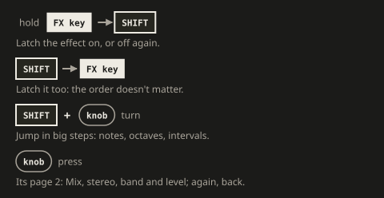

# Quick start

<!-- summary: Your levels, your first loop and your first effects, in ten minutes. -->

Your first ten minutes with FRIZZ. Every detail is in the [manual](MANUAL.md).

## How the sound flows

Plug a source into AUX. The looper records it **before** the effects, so you can play effects
over a loop and nothing gets printed into it. The effects come **after** the input/loop mix,
so they act on everything you hear, the input as well as the loop. No cable in AUX? Then the
input is CHOMPI's built-in microphone, which starts off the outputs so a speaker can't feed it
back
([Input: AUX, the mic or USB](MANUAL.md#input-aux-the-mic-or-usb)).

**SHIFT** means holding the CHOMPI key. The key lights white while it acts as SHIFT.

The **mode switch** picks the page: down is the play page, where all of this happens; up is
the [settings page](MANUAL.md#settings-page), for MIDI, the input and the LEDs. If the keys
don't play, flip it down.

## 1. Set your levels

| Do this | To set |
|---|---|
| Turn VOLUME | Output volume. The LED is a level meter |
| Press VOLUME, then turn | Input gain, AUX's, the mic's and USB's each their own. The LED is the input's meter, red where the loop would clip; while you turn, blue to red for the gain |
| Press again, then turn | Headphones: white = the master out, green = the input alone |
| Press again | Back to output volume |
| SHIFT + turn VOLUME | Input/loop mix: green = only the input, purple = only the loop |
| SHIFT + press VOLUME | Input/loop mix back to the loop only (with a loop) or the input only (without) |

Each press blinks the page's number in white: once for output, twice for input, 3 times for
the headphones.

Mono cable (TS) in AUX? See [Mono input](MANUAL.md#mono-input).

## 2. Record a loop

1. Press **LOOP** to start recording. LOOP turns red.
2. Play something.
3. Press **LOOP** again. The loop plays back immediately, and the input/loop mix jumps to only
   the loop, so you hear only the loop. Turn SHIFT + VOLUME back towards green to play along
   with it.
4. **PLAY** pauses and resumes it, when you let go of it.
5. Turn the big **transport knob** to change speed in semitones, from 2× down to 1/16×, on
   through a standstill and into reverse, up to −2×. Hold SHIFT while turning to jump in
   fifths and octaves. While paused, turning the knob scrubs. Press the knob to get back to normal speed.
6. Press **LOOP** to erase the loop. The input/loop mix jumps back to the input. To erase at
   the end of the loop instead, hold PLAY and press LOOP.

**In sync with a clock:** with MIDI clock coming in over TRS or USB, hold PLAY and press LOOP.
The recording then ends on a whole bar. Without a clock, or with the clock source set to
internal on the [settings page](MANUAL.md#settings-page), LOOP blinks red 3 times.

A loop can be up to 2:45 long and is gone when you switch off.

## 3. Play the effects

The white keys hold 13 effects, counted from the left, in the order the sound goes through
them, then the chaos key and the finalizer on white key 15 (below). The chaos key
makes no sound of its own: it drops the effects you've latched out at random and scrambles
the loop's steps (see [Chaos key](MANUAL.md#chaos-key)).

| White key | 1 | 2 | 3 | 4 | 5 | 6 | 7 | 8 | 9 | 10 | 11 | 12 | 13 | 14 | 15 |
|---|---|---|---|---|---|---|---|---|---|---|---|---|---|---|---|
| Effect | Freezer | Shifter | Folder | Crusher | Filter | Flanger | Phaser | Resonator | Slicer | Wow & flutter | Tape stop | Delay | Reverb | Chaos | Finalizer |

White key 7 has a second mode, the [frequency shifter](MANUAL.md#frequency-shifter): hold
SHIFT and tap the key twice (it turns ice blue); the same again goes back to the phaser.

- **Hold a key:** the effect is on while you hold it.
- **Hold a key, then SHIFT:** latch the effect on. Do it again, or just tap the key, to turn
  it off.
- **SHIFT, then a key:** pick the effect for the knobs without hearing it, to set it up
  before you punch it in. The key flashes.
- **Knobs 1-4:** shape the effect whose key you pressed or picked last. Their LEDs show the
  settings; a dark knob does nothing for that effect. The knobs follow one pattern: 1 is the
  main control, 2 the feedback, 3 the tone or colour, 4 a setting of the effect's own, or a
  send's ducking (where an effect has no such setting, it puts another one there).
- **SHIFT + turn a knob:** jump in big steps: notes, octaves or musical intervals where the
  setting has them, 10% otherwise.
- **SHIFT + press a knob:** reset that setting.
- **Press a knob:** the effect's [page 2](MANUAL.md#page-2): Mix, stereo, band and level, the
  same on every effect but the chaos key; press again for page 1. Knob 4 (level) tames an
  effect that gets loud, like the folder driven hard. The finalizer has no page 2: in its EQ,
  Comp and Width a press of knob 1, 2 or 3 mutes that band, and another brings it back.

Every effect starts silent or nearly so: one knob brings it in. That's knob 1 on most, knob 2
(feedback) on the resonator and knob 3 (amount, depth) on the flanger and the phaser. The
freezer, slicer, tape stop, delay and reverb work from the first press: the freezer repeats a
whole bar, the slicer pumps gently, the tape stop stops, and the delay and reverb throw
echoes and a room (their level is knob 4 on their page 2, as every effect's).

**Finalizer:** press white key 15, and knobs 1-4 set the master section on the outputs,
neutral at first. They show its Level module: the input, a drive and its type (Boost, Tube,
Fuzz), and Loud, which pushes the sound into a limiter so it gets louder without clipping.
Hold SHIFT and tap key 15 for the next module: EQ (yellow) for the low, mid and high bands,
Comp (cyan) to compress them (knob 4, Depth, brings it in), Width (blue) for each band's
stereo; SHIFT + key 15 again goes on. Its key turns red when the output is so loud the safety
limiter has to step in. FRIZZ remembers its settings when you switch off. Press an effect key
to give the knobs back to the effect. See [Finalizer](MANUAL.md#finalizer).

Delay and reverb tails keep ringing after you let go. The other effects stop the moment you
release the key, except the tape stop, which spins back up first. Effect settings reset when
you switch off, unless you save them as a scene.

Things to try first:

- **Freezer (white key 1)** on a beat: hold SHIFT, tap the key, and keep holding SHIFT while
  you turn knob 1 down 5 clicks to 1/8 (without SHIFT, a step takes 3 clicks). It grabs that
  much from the moment you press and repeats it while you hold the key. Turn knob 3 right 3
  clicks at a time (with SHIFT, 1) for a roll: each step halves the repeat, and back at off
  it's the whole length again.
- **Shifter (white key 2):** hold SHIFT, tap the key, and with SHIFT still held turn knob 1 up
  2 clicks for a fifth, then hold the key to hear it.
- **Resonator (white key 8)** with the crusher or the shifter latched: the ringing goes through
  them on every pass.
- **Phaser (white key 7):** latch it, turn knob 3 (depth) up to hear the sweep and knob 2 for
  its resonance. Turn knob 1 right past the centre (its LED turns green) and the sweep locks
  to the tempo, 1/16 first, slower as you go on. With the resonator latched too, the sweep
  moves through its ringing. Hold SHIFT and tap the key twice: it turns ice blue, a
  [frequency shifter](MANUAL.md#frequency-shifter). Knob 1 at a few Hz, knob 2 up and knob 4
  (the direction) turned to one side make a barber pole that rises, or falls, forever.
- **Delay + reverb (white keys 12 and 13):** tap them to throw echoes and tails onto single
  notes.
- **Tape stop (white key 11)** with the delay or reverb latched: hold it on a beat and the
  music winds down over half a bar while the tails ring on. Let go and it spins back up.

The freezer, slicer, filter LFO, tape stop, delay, the phaser (its rate turned right of the
centre) and the chaos key's grid follow a tempo: the loop's while there is one, so
they lock to it; otherwise MIDI clock, or the last tempo (120 BPM at power-on). Hold SHIFT
and tap LOOP 3 times or more to tap a tempo, or to tell FRIZZ how many beats a loop has.
See [Tempo and transport](MANUAL.md#tempo-and-transport).

## 4. Save scenes

5 dark keys in the middle hold scenes: every effect's settings and latches. They go from the
lower F# to the upper D#. The first is the blank scene: it turns every effect off and resets
the knobs, and can't be saved over. The other 4 are yours.

- **Save:** tap the upper F# (green), tap a scene key, tap the CHOMPI key to confirm.
- **Recall:** press a scene key. Try a busy scene on one key and a sparse one on the next,
  then the first key to turn every effect off.
- **Morph:** hold SHIFT and press a scene key, then let go of SHIFT: the effects glide there
  and land at the end of the bar. Before you let go, tap the key again for one bar more per
  tap; the bars count from when you let go.
- **Drop:** with SHIFT still held after the scene key, press the transport knob instead: the
  scene lands hard on the bar line (its key blinks red until then).
- **Stop or change it:** hold SHIFT again and press the blinking key to stop it where it is,
  or another scene key to start a new one from there.
- **Copy and delete:** the same steps with the upper G# (blue) and upper A# (red). Tap the
  function's key again to back out.

The crossfader and the build-up come from the same SHIFT hold: see
[Timed scene changes](MANUAL.md#timed-scene-changes).

While you save, copy or delete, the scene keys you can tap light in the function's colour,
and the CHOMPI key blinks in it when there's something to confirm. White means done.

Scenes are stored on the SD card. See the [manual](MANUAL.md#fx-scenes) for the details.

The two dark keys left of the scenes, the lower C# and D#, glow dimly when the SD card holds
loops: yours on the lower C#, TAPE's recordings on the lower D#. Hold SHIFT and press one to
open its page, where the white keys play those loops; two quick taps of SHIFT take you back.
See [Playing loops](MANUAL.md#playing-loops).

## Where next

- [Manual](MANUAL.md): what every knob does on every effect
- [Loop loader](MANUAL.md#loop-loader): your own loops from the SD card, SHIFT + the lower C#,
  and TAPE's recordings, SHIFT + the lower D#; the [Companion](MANUAL.md#the-companion) puts
  them on the card over the USB cable
- [USB audio](MANUAL.md#usb-audio): FRIZZ as a sound card, to record it on a computer or play
  into it
- [Install guide](INSTALL.md): updating FRIZZ, going back to stock firmware
